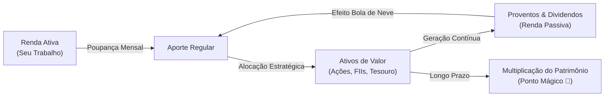

# Aula 1.1 — O que é Investimento Real: O Tripé Patrimonial & A Geração de Renda

Bem-vindo ao início da sua jornada na **Academia MANTFRAI**.

Antes de abrir planilhas, olhar gráficos ou comprar a primeira cota na Bolsa de Valores, é fundamental construir um alicerce inabalável. Mais de 90% das pessoas que perdem dinheiro no mercado financeiro fracassam não por falta de inteligência matemática, mas por começarem com premissas erradas: confundem investimento com aposta, buscam enriquecimento da noite para o dia e tomam decisões no calor das emoções.

Nesta primeira aula, vamos desmistificar o que realmente é um investimento de valor e entender os três motores que constroem a riqueza duradoura.

---

## 💡 1. A Grande Ideia: O que é um "Ativo de Valor"?

No cotidiano profissional, a maioria das pessoas troca **tempo por dinheiro**: você trabalha 8 a 10 horas por dia e, no final do mês, recebe o seu salário. Se você parar de trabalhar amanhã, a sua renda cessa imediatamente.

**Investir é exatamente o processo inverso:** é pegar uma parte do fruto do seu trabalho e alocar em um **Ativo de Valor**.

> 💎 **Definição MANTFRAI:** Um ativo de valor é um bem produtivo (uma fração de uma empresa lucrativa, um imóvel comercial alugado ou um título de dívida soberana) que trabalha 24 horas por dia para gerar retorno financeiro **sem exigir o seu tempo ou esforço físico**.

Todo investimento sólido se apoia sobre o **Tripé da Riqueza**:
1. **O Aporte:** O capital que você poupa mensalmente da sua renda ativa.
2. **O Ativo de Valor:** Onde você coloca esse capital (empresas com lucros consistentes, imóveis de primeira linha e títulos indexados à inflação).
3. **O Tempo:** O período em que você permite que os juros compostos trabalhem sem intervenção emocional.

---

## 📈 2. As Duas Engrenagens da Renda Passiva

Quando você aloca seus aportes em ativos de valor, o retorno financeiro se manifesta de duas maneiras complementares:

### Engrenagem A: Valorização do Capital (Crescimento Patrimonial)
Você adquire uma cota de um Fundo Imobiliário ou ação por R$ 100,00. À medida que a economia se desenvolve, os imóveis se valorizam e as empresas expandem seus negócios, essa mesma cota passa a valer R$ 115,00. Você teve um ganho de capital de R$ 15,00.

### Engrenagem B: Os Proventos (Dividendos e Aluguéis Mensais)
Esta é a engrenagem mais poderosa da liberdade financeira. Ao se tornar sócio de empresas como Itaú, Vale ou de grandes galpões logísticos na B3, você tem o direito legal de receber parte dos lucros líquidos distribuídos aos acionistas. 
- Mesmo que o preço da cota oscile no mercado no curto prazo, o aluguel e o dividendo continuam pingando na sua conta corrente todos os meses, isentos de imposto de renda no caso dos FIIs.

---

## ❄️ 3. O Efeito Bola de Neve: O Reinvestimento Inteligente

Se você receber os proventos mensais e gastá-los em consumo imediato, seu patrimônio continuará crescendo apenas na velocidade dos seus aportes do trabalho.

Porém, quando você **reinveste 100% dos proventos recebidos**, aciona o efeito bola de neve dos juros compostos:
- No primeiro mês, seus aportes compram 10 cotas.
- No segundo mês, os rendimentos dessas 10 cotas compram mais 1 cota. Agora você tem 11 cotas gerando renda.
- No terceiro mês, são 11 cotas gerando proventos ainda maiores, permitindo comprar 2 novas cotas sem tirar nada do bolso.

Esse ciclo acelera de forma exponencial até atingir o que chamamos no Filtro MFS de **Ponto Mágico (Magic Number)**: o dia em que os proventos mensais pagam todas as contas da sua família, tornando o trabalho uma escolha de realização pessoal, e não uma obrigação de sobrevivência.

---

## 📱 4. Aplicação Prática no App MANTFRAI

No **MANTFRAI Enterprise**, você não precisa calcular o efeito bola de neve na mão:
1. Acesse o menu **Renda Passiva** (`/renda-passiva`).
2. Observe o card **Renda Média Mensal** e o gráfico de evolução histórica dos seus dividendos.
3. Utilize o **Simulador de Futuro** no final da tela para projetar o impacto do reinvestimento dos seus dividendos daqui a 5, 10 e 20 anos.

---

## ⚠️ 5. O Erro Fatal do Amador (Ponto de Atenção)

> 🚫 **O Erro:** Tratar ações e FIIs como "bilhetes de loteria" ou fichas de cassino, comprando na empolgação das notícias e vendendo no desespero quando a cotação cai temporariamente.
> 
> 🛡️ **A Postura MANTFRAI:** Quem investe pelo Filtro MFS não compra códigos na tela para revender amanhã. Compramos **participações em negócios reais**. Se os fundamentos continuam sólidos e a empresa lucra, a queda de preço é apenas uma oportunidade de comprar mais barato pelo motor RDM.

---

## 📊 6. Infográfico: O Ciclo da Riqueza Antifrágil

---

## 🎙️ 7. Prompt para Áudio no Google NotebookLM

> **Como gerar o podcast desta aula:**
> 1. Copie o texto desta aula.
> 2. Cole como nova fonte em [notebooklm.google.com](https://notebooklm.google.com/).
> 3. No campo de personalização do *Audio Overview*, cole a instrução abaixo e clique em **Generate**:
> 
> *"Crie um episódio de podcast leve e instigante entre dois apresentadores especialistas explicando a diferença entre trocar tempo por dinheiro e construir um império de ativos com o MANTFRAI. Enfatize a analogia da bola de neve e o conceito do Ponto Mágico, onde cada cota comprada vira um funcionário trabalhando 24 horas por dia para gerar renda passiva."*

---

## ✅ 8. Checklist de Conclusão da Aula

Antes de avançar para a próxima aula, valide se você dominou os conceitos essenciais:
- [ ] Sei explicar com minhas próprias palavras o que é um ativo de valor.
- [ ] Compreendi a diferença entre valorização de cota e recebimento de proventos.
- [ ] Entendi por que reinvestir dividendos acelera o efeito bola de neve.
