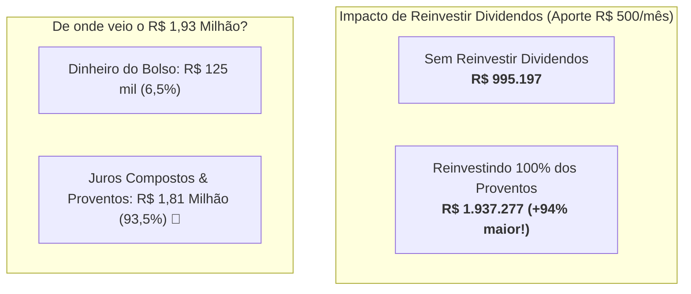

# Aula 1.2 — A Base Inegociável: O Estudo de 20 Anos que Revela o Poder dos Proventos

Na aula anterior, entendemos o conceito de ativo de valor e como os juros compostos funcionam como uma bola de neve. Hoje, vamos além da teoria e examinaremos um **estudo de caso com dados reais de 20 anos** na Bolsa de Valores brasileira para comprovar a diferença matemática brutal entre quem apenas poupa e quem reinveste os proventos.

---

## 🔬 1. A Grande Ideia: O Experimento dos Dois Investidores

Imagine dois investidores, Carlos e Eduardo, que começaram suas jornadas financeiras exatamente no mesmo dia, com as mesmas condições:
- **Aporte Inicial:** R$ 5.000,00.
- **Aporte Mensal:** R$ 500,00 rigorosamente todos os meses.
- **Ativo Escolhido:** Ações de uma empresa sólida e perene do setor elétrico brasileiro (Engie Brasil - EGIE3).
- **Prazo:** 20 anos ininterruptos.

A única diferença entre os dois foi a decisão sobre o que fazer com os **proventos e dividendos** recebidos:

### Cenário 1: Carlos (Consumiu os Dividendos)
A cada mês, sempre que a empresa distribuía dividendos e JCP, Carlos transferia o dinheiro para sua conta corrente e gastava. Ele manteve os R$ 500 mensais de aporte do próprio bolso.
- **Resultado após 20 anos:** R$ 995.197,00 (cerca de R$ 1 milhão acumulado). Um ótimo resultado, impulsionado pela valorização da empresa.

### Cenário 2: Eduardo (Reinvestiu 100% dos Dividendos)
Eduardo seguiu o **Método DAVI**. Cada centavo de dividendo que entrava na conta era somado ao aporte mensal de R$ 500 para comprar mais ações da companhia.
- **Resultado após 20 anos:** **R$ 1.937.277,00**!

> 💥 **A Revelação Matemática:** Reinvestir os proventos gerou quase **R$ 1 milhão a mais** para Eduardo com exatamente o mesmo esforço de trabalho que Carlos!

---

## 📊 2. De Onde Veio Esse Dinheiro? O Segredo do Esforço Próprio vs Juros Compostos

Ao analisar o patrimônio final de Eduardo (R$ 1.937.277,00), os números surpreendem:
- **Total que realmente saiu do bolso de Eduardo:** Apenas **R$ 125.000,00** (R$ 5.000 iniciais + R$ 500 x 240 meses).
- **Total gerado exclusivamente pelos juros compostos e dividendos:** **R$ 1.812.277,00**!

Ou seja: **mais de 93% de todo o patrimônio acumulado não foi fruto do suor do trabalho**, mas sim do próprio dinheiro trabalhando dia e noite através do reinvestimento sistemático!

E o mais impactante: ao final desses 20 anos, esse patrimônio acumulado passa a gerar uma **renda passiva mensal superior a R$ 10.890,00**, pingando na conta todos os meses sem que Eduardo precise trabalhar nem mais um minuto.

---

## 🏛️ 3. O Tripé Inegociável dos Investimentos

Assim como um banco de três pernas não fica de pé se uma delas for retirada, o sucesso nos investimentos depende exclusivamente de três fatores:

1. **O Aporte:** O combustível do sistema. Investimento não faz mágica do zero; ele multiplica o que é colocado.
2. **O Ativo de Valor:** Colocar o dinheiro em negócios que lucram e crescem. Se você aportar em empresas falimentares ou especulações sem lucro, o tripé cai.
3. **O Tempo:** O oxigênio dos juros compostos. Tirar o dinheiro antes da hora interrompe a curva exponencial.

---

## 📱 4. Aplicação Prática no App Norte Invest

No **Norte Invest V2 Enterprise**, você acompanha a saúde do seu tripé em tempo real:
1. Abra o **Resumo da Carteira** (`/resumo`).
2. Veja o gráfico **Evolução do Capital Aplicado × Patrimônio Consolidado**.
3. Repare na separação nítida entre a linha azul (**Capital que saiu do seu bolso**) e a linha verde (**Patrimônio Real a Mercado impulsionado pelos proventos**). O objetivo da metodologia é fazer a linha verde se distanciar cada vez mais para cima!

---

## ⚠️ 5. O Erro Fatal do Amador (Ponto de Atenção)

> 🚫 **O Erro:** Usar os dividendos recebidos no início da jornada para pagar pequenos luxos cotidianos (comer fora, comprar roupas), matando a bola de neve ainda filhote.
> 
> 🛡️ **A Postura Norte Invest:** Nos primeiros anos da formação patrimonial, **100% dos dividendos devem ser reinvestidos**. Você só começa a usufruir da renda passiva quando atinge o seu objetivo de independência financeira ou quando a renda cobre com folga o seu custo de vida.

---

## 📊 6. Infográfico: O Poder do Reinvestimento (20 Anos de Simulação Real)

---

## 🎙️ 7. Prompt para Áudio no Google NotebookLM

> **Como gerar o podcast desta aula:**
> Cole a instrução abaixo no *Audio Overview* do NotebookLM com este texto:
> 
> *"Crie um episódio dinâmico de podcast analisando o estudo real de 20 anos na Bolsa brasileira entre Carlos e Eduardo. Os apresentadores devem discutir com entusiasmo a impressionante descoberta de que mais de 93% da fortuna final não veio do salário do investidor, mas do reinvestimento de dividendos. Destaque o Tripé dos Investimentos e alerte os ouvintes sobre o perigo de gastar os proventos antes do Ponto Mágico."*

---

## ✅ 8. Checklist de Conclusão da Aula

- [ ] Entendi a diferença matemática de quase R$ 1 milhão entre reinvestir e gastar proventos.
- [ ] Sei que o segredo dos juros compostos depende do Tripé: Aporte, Ativo de Valor e Tempo.
- [ ] Acessei a tela de Resumo da minha carteira e verifiquei a proporção entre Capital Aplicado e Patrimônio.
