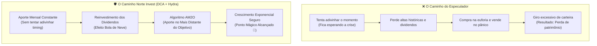

# Aula 1.3 — A Construção da Riqueza: Constância vs Timing

Na aula anterior, provamos cientificamente através de 20 anos de dados na B3 que os **proventos reinvestidos** respondem por mais de dois terços do patrimônio final de um investidor de longo prazo.

Agora, chegamos à pergunta que separa os investidores amadores dos investidores inteligentes:
> *"Quanto devo investir, e principalmente, **quando** devo comprar ativos na Bolsa de Valores? Devo guardar dinheiro na poupança e esperar uma grande crise para comprar barato, ou investir todos os meses religiosamente?"*

Nesta aula, vamos desconstruir os maiores mitos do mercado com base em estudos de universidades renomadas (Yale e Universidade da Califórnia) e aprender a metáfora essencial que vai blindar o seu comportamento para sempre.

---

## ⏰ 1. O Mito do Momento Perfeito: O Estudo de Yale (DCA vs Buy the Dip)

O senso comum diz que você deveria ser um "adivinho": guardar dinheiro na renda fixa e esperar a Bolsa cair 30% ou 40% em uma crise para entrar com tudo.

Cientistas e economistas da Universidade de Yale resolveram colocar essa tese à prova em um estudo histórico comparando dois perfis de investidores durante décadas:
1. **O Investidor "Adivinho" (Buy the Dip Perfeito):** Tinha o dom sobrenatural de prever exatamente o fundo do poço de cada grande crise e comprava apenas nas mínimas históricas. Enquanto a crise não vinha, ele deixava o dinheiro parado rendendo taxa básica de juros.
2. **O Investidor Constante (Dollar Cost Averaging - DCA):** Não olhava notícias, não tentava adivinhar o futuro e não esperava crise. Simplesmente pegava o dinheiro que sobrava do salário e investia **todo santo mês**, na mesma data, independentemente de a Bolsa estar em alta ou em baixa.

### O Resultado Chocante do Estudo:
Ao final de décadas, **o Investidor Constante (DCA) terminou com um patrimônio substancialmente maior** do que o investidor que acertou todos os fundos de crise!

### Por que isso acontece?
- Enquanto o "adivinho" ficava anos esperando uma crise com dinheiro na renda fixa, o mercado subia 100%, 200%, 300%. Quando a crise finalmente chegava e a Bolsa caía 30%, ela caía de um patamar tão alto que ainda estava muito mais cara do que quando o investidor constante começou a comprar.
- Além disso, o investidor constante coletou dividendos ao longo de todos aqueles anos e os reinvestiu no efeito bola de neve, enquanto o dinheiro parado rendia juros simples.

> 💡 **Conclusão Científica:** Tentar acertar o *timing* do mercado é uma ilusão que custa caro. A melhor data para investir foi há 10 anos; a segunda melhor data é **hoje e todos os meses em que você receber sua renda**.

---

## 🧠 2. O Estudo "Boys will be Boys": O Custo Oculto da Ansiedade

Outro estudo emblemático das finanças comportamentais, conduzido pelos pesquisadores Brad Barber e Terrance Odean na Universidade da Califórnia (*"Boys will be Boys: Gender, Overconfidence, and Common Stock Investment"*), analisou mais de 35.000 contas de investidores ao longo de anos.

A constatação foi taxativa:
- Homens tinham uma tendência 45% maior de girar a carteira, comprar e vender papéis frequentemente acreditando que sabiam para onde o mercado iria.
- **O Resultado:** Quanto mais operações o investidor realizava, **pior era a sua rentabilidade final**. O excesso de giro gerava custos operacionais, impostos desnecessários e, invariavelmente, compra no topo da euforia e venda no fundo do pânico.

> 📉 **A Regra de Ouro:** No mercado financeiro, a hiperatividade é punida e a **disciplina paciente é ricamente recompensada**.

---

## 🏷️ 3. O Viés da Ancoragem e o "Efeito Blusinha"

Por que tantas pessoas perdem dinheiro comprando ações de empresas em decadência (como antigas gigantes que entraram em recuperação judicial)? 

A resposta está em um viés cognitivo chamado **Ancoragem**.

Pense no comércio varejista: você entra em uma loja e vê uma blusa com uma etiqueta:  
`De R$ 500,00 por apenas R$ 99,00! 🏷️`  
Seu cérebro imediatamente âncora nos R$ 500,00 e acredita estar fazendo um negócio espetacular, mesmo que a blusa tenha sido fabricada com tecido de baixa qualidade e não valha nem R$ 30,00.

Na Bolsa acontece exatamente a mesma coisa:
- O amador vê uma ação que custava R$ 100,00 há 3 anos e hoje está custando R$ 5,00. Ele pensa: *"Nossa, caiu 95%, está dada de graça! Se voltar para R$ 50,00 eu fico rico!"*
- O que ele não percebeu: o preço caiu porque a empresa acumulou bilhões em dívidas, perdeu todos os clientes e está à beira da falência. **Preço que caiu não é garantia de desconto; muitas vezes é reflexo de destruição de valor.**

> 🛡️ **No Norte Invest:** Preço é o que você paga; **Valor é o que você recebe**. Nunca compre um ativo só porque ele parece "barato" na cotação. Só compramos negócios com lucros consistentes, margens altas e baixa alavancagem.

---

## 🍎 4. A Metáfora do Pomar: Cultivar Frutas ou Ervas Daninhas?

Imagine que você decidiu plantar um pomar de laranjeiras para viver da colheita de laranjas no futuro:
- No primeiro ano, você rega as mudas e cuida da terra.
- No terceiro ano, as árvores começam a dar os primeiros frutos.
- Se em um dia de tempestade o vento derrubar algumas folhas ou se o preço da saca de laranja cair no mercado local, você pegaria uma motosserra para derrubar todas as suas laranjeiras saudáveis? **Claro que não!** As laranjeiras continuam férteis e voltarão a produzir ano que vem.

Agora, olhe o que o investidor emocional faz na Bolsa:
1. Ele compra cotas de uma empresa lucrativa ou de um galpão logístico excelente (a laranjeira fértil).
2. A cotação cai 10% por causa de uma notícia política qualquer.
3. Em pânico, ele vende o ativo excelente com prejuízo (derruba a laranjeira).
4. Em seguida, pega esse dinheiro e compra uma ação especulativa de centavos que subiu 20% no dia (planta uma erva daninha esperando que ela dê frutos milagrosos).

No **Método DAVI & Hydra**, nós somos agricultores de proventos: plantamos boas árvores, alimentamos com adubo (aportes mensais) e deixamos que a natureza dos juros compostos faça a colheita.

---

## 📱 5. Como o App Norte Invest Protege Você na Prática

Você não precisa lutar contra a sua própria mente ou ter medo de comprar na hora errada:
1. **O Algoritmo AM2O (`/onde-aportar`):** O Norte Invest calcula matematicamente qual classe de ativo e qual papel está mais para trás em relação à sua meta patrimonial. Ele faz você comprar ativos de valor com desconto natural, de forma mecânica, sem hesitação e sem tentar adivinhar notícias.
2. **Radar de Ativos (`/radar`):** Filtra automaticamente apenas empresas com selo de governança, ROE robusto e endividamento sob controle, impedindo que você caia na armadilha da ancoragem em empresas podres.
3. **Definir Objetivos (`/definir-objetivos`):** Estabelece os percentuais ideais da sua Carteira Hydra para que nenhum evento isolado de mercado balance a sua tranquilidade.

---

## ⚠️ 6. Resumo dos Erros Fatais a Evitar

| Erro do Amador | Postura do Investidor Norte Invest |
| :--- | :--- |
| Esperar a "próxima crise" com dinheiro parado para tentar acertar o fundo. | **Aporte mensal constante (DCA):** acumula mais patrimônio e aproveita os proventos. |
| Girar a carteira o tempo todo buscando a "ação do momento". | **Comprar e manter (Buy & Hold de Valor):** menos taxas, menos impostos, mais paz de espírito. |
| Achar que ação que caiu 90% está "barata" (ancoragem). | **Avaliação por fundamentos:** só investe onde há lucro, caixa e gestão comprovada. |
| Vender bons ativos no pânico temporário. | **Compreensão do pomar:** foco nos dividendos gerados e rebalanceamento frio pelo AM2O. |

---

## 📊 7. Infográfico: Disciplina vs Tentativa de Adivinhação

---

## 🎙️ 8. Prompt para Áudio no Google NotebookLM

> **Como gerar o podcast desta aula:**
> 1. Copie todo o conteúdo desta aula.
> 2. Cole como nova fonte em [notebooklm.google.com](https://notebooklm.google.com/).
> 3. No campo de personalização do *Audio Overview*, cole a instrução abaixo e clique em **Generate**:
> 
> *"Apresentem uma discussão cativante e de alto nível sobre a ciência do comportamento financeiro. Contem a história do estudo de Yale sobre DCA versus tentar acertar o fundo do poço, debatam o estudo 'Boys will be Boys' sobre os perigos de girar a carteira, e usem com vivacidade o exemplo da blusinha em promoção e a metáfora do pomar de laranjas para explicar por que a constância e o método AM2O do Norte Invest vencem qualquer tentativa de adivinhação do mercado."*
