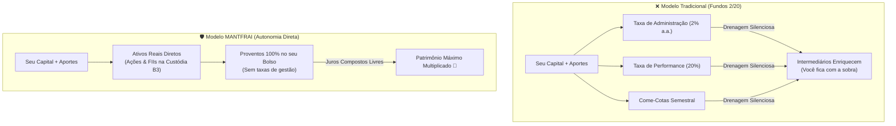

# Aula 2.1 — Autonomia Real vs A Armadilha dos Intermediários

Existe um provérbio clássico em Wall Street que resume com precisão a indústria financeira tradicional:
> *"Quando alguém com experiência encontra alguém com dinheiro, o que tem dinheiro sai com experiência, e o que tinha experiência sai com o dinheiro."*

A imensa maioria dos brasileiros que tenta começar a investir recorre ao gerente do banco tradicional ou a relatórios patrocinados de corretoras. O resultado costuma ser sempre o mesmo: produtos empacotados, fundos multimercado caros, títulos de capitalização e planos de previdência recheados de taxas ocultas.

Nesta aula, você vai entender com números reais como as taxas de administração e performance destroem o efeito bola de neve ao longo das décadas — e por que a **autonomia direta do investidor** é o primeiro grande pilar do MANTFRAI.

---

## 🛑 1. O Pedágio Invisível: O Modelo "2 com 20"

A maioria dos fundos de investimento em ações e multimercados do mercado opera no chamado modelo **2/20**:
1. **Taxa de Administração (Ex: 2% ao ano):** Cobrada **sobre todo o seu patrimônio acumulado**, independentemente de o fundo dar lucro ou prejuízo. Se o fundo cair 20% no ano, o gestor ainda assim retira 2% do seu dinheiro para manter a estrutura dele.
2. **Taxa de Performance (Ex: 20% sobre o que exceder o benchmark):** Se o fundo render acima do CDI ou do Ibovespa, o gestor fica com um quinto de todo o lucro extra.
3. **Come-Cotas e Tributação Antecipada:** Nos fundos tradicionais, semestralmente o governo abocanha uma fatia das suas cotas a título de imposto de renda antecipado, interrompendo a curva dos juros compostos.

---

## 📊 2. O Caso Berkshire Hathaway: Onde Foram Parar R$ 7 Milhões?

Para compreender o impacto brutal desse "pedágio" ao longo do tempo, considere um estudo real baseado no histórico da **Berkshire Hathaway**, a holding gerida por Warren Buffett:

Imagine que você investiu **US$ 1.000** na empresa de Buffett e manteve esse investimento ao longo de décadas:
- **Investimento Direto (Autonomia MANTFRAI):** Os US$ 1.000 originais se multiplicaram sem taxas de administração e alcançaram aproximadamente **US$ 8.000.000** (oito milhões de dólares) na sua conta.
- **Investimento via Fundo Tradicional (Taxa de 2% ao ano + 20% de performance):** O mesmo capital, aplicado exatamente nos mesmos ativos pelo mesmo período, entregaria na sua mão apenas cerca de **US$ 720.000**.

> 🚨 **Onde foram parar os outros US$ 7.280.000?**  
> Ficaram integralmente nos bolsos dos intermediários (gestores, custodiantes e distribuidores). Mais de **90% do fruto do seu tempo e da sua paciência** foi drenado por taxas que pareciam inofensivas de 2% ao ano!

---

## 🏛️ 3. Por que o Investidor Direto Vence o Gestor Profissional?

Muitos investidores iniciantes sofrem da síndrome do impostor: *"Como eu, que sou médico, engenheiro, professor ou empresário, vou investir melhor do que um gestor de terno na Faria Lima?"*

A resposta reside na estrutura de incentivos:
- **O Gestor do Fundo:** Precisa apresentar relatórios trimestrais, dar satisfações a cotistas ansiosos, sofre risco de saques em massa no fundo da crise (sendo forçado a vender ações na baixa) e é remunerado pelo tamanho do fundo (AUM), não necessariamente pelo seu sucesso em 20 anos.
- **Você com o MANTFRAI:** Não tem pressa, não precisa prestar contas a cotistas de curto prazo, não sofre pressão de resgate e investe diretamente em ações sólidas e fundos imobiliários **com custo de administração zero na custódia**.

---

## 📱 4. Aplicação Prática no App MANTFRAI

No **MANTFRAI Enterprise**, você assume o controle total do seu patrimônio com a máxima simplicidade:
1. **Radar de Ativos (`/radar`):** Você consulta diretamente os indicadores fundamentais de cada empresa e fundo imobiliário sem depender de opiniões enviesadas de corretores.
2. **Histórico Transparente (`/historico`):** Registra suas ordens e proventos sem nenhuma taxa oculta de intermediação.
3. **Resumo Patrimonial (`/resumo`):** Visualize a evolução líquida do seu capital trabalhando para você, e não para sustentar estruturas de terceiros.

---

## ⚠️ 5. O Erro Fatal do Amador

> 🚫 **O Erro:** Achar que investir por conta própria significa passar o dia inteiro grudado na tela operando gráficos e notícias como um day trader.
> 
> 🛡️ **A Postura MANTFRAI:** Nós não somos operadores de bolsa; somos **sócios de grandes empreendimentos**. Com a metodologia e as ferramentas do MANTFRAI, você dedica apenas **15 minutos uma vez por mês** para executar seus aportes frios pelo algoritmo Motor RDM.

---

## 📊 6. Infográfico: A Erosão Patrimonial das Taxas

---

## 🎙️ 7. Prompt para Áudio no Google NotebookLM

> **Como gerar o podcast desta aula:**
> 1. Copie o texto desta aula.
> 2. Cole como nova fonte em [notebooklm.google.com](https://notebooklm.google.com/).
> 3. No campo de personalização do *Audio Overview*, cole a instrução abaixo e clique em **Generate**:
> 
> *"Produzam um episódio esclarecedor e dinâmico sobre a liberdade e a autonomia financeira. Expliquem detalhadamente como o 'pedágio invisível' dos fundos tradicionais (taxa de 2% de administração e 20% de performance) destruiu o patrimônio de quem investiu via terceiros, usando a impressionante comparação dos 8 milhões de dólares da Berkshire Hathaway. Reforcem como o investidor comum, munido das ferramentas do MANTFRAI, ganha paz e resultado ao investir de forma direta em apenas 15 minutos mensais."*
