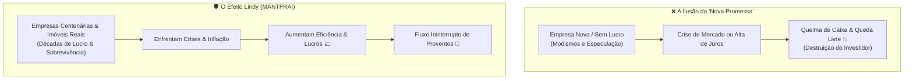

# Aula 2.2 — O Segredo dos Melhores Ativos & O Efeito Lindy

No mundo dos investimentos, a intuição humana costuma pregar uma peça traiçoeira: costumamos acreditar que o futuro pertence exclusivamente ao que é "novo", "disruptivo" e "revolucionário". 

Quantas vezes você já ouviu alguém dizer:  
*"Você precisa comprar a ação daquela startup que abriu capital semana passada, ela vai ser a nova gigante da inteligência artificial!"*?

A realidade histórica dos dados mostra o oposto: mais de 80% das empresas que prometem revolucionar o mundo terminam em falência ou destruição maciça de valor. Nesta aula, você vai conhecer uma das leis mais elegantes da probabilidade — **o Efeito Lindy** — e entender por que a longevidade comprovada é o melhor selo de qualidade para a sua carteira.

---

## ⏳ 1. O que é o Efeito Lindy?

O conceito nasceu na década de 1960 em Nova York, em uma delicatessen chamada *Lindy's*, onde atores, dramaturgos e produtores da Broadway se reuniam após as apresentações. 

Eles notaram um fenômeno curioso sobre as peças de teatro:
- Se uma peça da Broadway estreou ontem, é impossível prever se ela durará mais de uma semana em cartaz.
- Porém, se uma peça já está em cartaz ininterruptamente há **10 anos**, a probabilidade estatística de que ela continue em cartaz por mais 10 anos é extremamente alta.

Mais tarde, o matemático e ensaísta **Nassim Nicholas Taleb** formalizou esse princípio para a economia e os investimentos:

> 📜 **A Lei de Lindy:** Para coisas não-perecíveis (ideias, livros, tecnologias e empresas), **a expectativa de vida futura é proporcional ao tempo que elas já sobreviveram no passado**. O tempo é o melhor juiz e o mais implacável destruidor de fragilidades.

---

## 🏢 2. O Efeito Lindy Aplicado às Empresas e Imóveis

Pense no Brasil: nosso país já enfrentou hiperinflação de 80% ao mês, congelamento de poupança, mudanças repentinas de moeda (Cruzeiro, Cruzado, Real), dezenas de presidentes, impeachment, crises globais e taxas de juros estratosféricas.

- Se uma empresa como a **Weg**, o **Itaú**, o **Banco do Brasil** ou a **Klabin** atravessou todas essas tempestades nas últimas décadas, continuou lucrativa, pagou dividendos a todos os seus acionistas e expandiu suas operações, qual a probabilidade de ela falir na próxima terça-feira? **Praticamente nula.**
- Por outro lado, aquela empresa de tecnologia da moda que realizou IPO ontem, nunca deu um centavo de lucro líquido e queima caixa na esperança de um dia ser rentável, tem uma fragilidade imensa diante da menor subida na taxa de juros.

Investir com sabedoria não é adivinhar o futuro; é **associar-se a negócios que já foram testados pelo tempo e sobreviveram com louvor**.

---

## 🧩 3. As 4 Classes de Ativos Antifrágeis do MANTFRAI

Para que o Efeito Lindy trabalhe a seu favor, o MANTFRAI estrutura o seu império financeiro sobre quatro pilares comprovados:

1. **Ações Brasileiras de Valor:** Participação em empresas líderes de setores perenes da economia (energia elétrica, bancos, saneamento, seguros e indústria de base).
2. **Fundos de Investimento Imobiliário (FIIs):** Propriedade compartilhada dos melhores imóveis físicos do país (galpões logísticos de alto padrão, lajes corporativas classe A e shoppings consolidados) gerando aluguéis mensais isentos de IR.
3. **Renda Fixa Pública & Reserva de Valor:** Títulos soberanos indexados ao IPCA e com liquidez imediata para garantir poder de compra e segurança inabalável.
4. **Ativos Globais & Dolarizados (Stocks & REITs):** Participação nas maiores corporações do planeta cotadas na moeda de reserva mundial (o Dólar), protegendo seu poder de compra contra desvalorizações cambiais da moeda local.

---

## 📱 4. Aplicação Prática no App MANTFRAI

O **MANTFRAI Enterprise** já incorpora o Efeito Lindy de fábrica:
1. **Radar de Ativos (`/radar`):** Filtra automaticamente o histórico dos ativos, exigindo histórico mínimo de lucratividade e governança corporativa no Novo Mercado.
2. **Definir Objetivos (`/definir-objetivos`):** Permite distribuir as porcentagens ideais entre Ações, FIIs, Renda Fixa e Exterior com base na solidez de cada classe.
3. **Onde Aportar (`/onde-aportar`):** Prioriza os ativos aprovados no radar que estão com as melhores oportunidades de preço no mês.

---

## ⚠️ 5. O Erro Fatal do Amador

> 🚫 **O Erro:** Sofrer de FOMO (*Fear of Missing Out* / Medo de Ficar de Fora) e comprar ações especulativas de empresas deficitárias só porque o amigo do trabalho ou um influenciador do YouTube disse que *"vai subir 1000%"*.
> 
> 🛡️ **A Postura MANTFRAI:** Ignoramos promessas e ruídos vazios. Nós só colocamos nosso dinheiro suado onde há lucros consistentes, balanços auditados e resiliência provada no teste do tempo.

---

## 📊 6. Infográfico: O Filtro do Tempo (Efeito Lindy)

---

## 🎙️ 7. Prompt para Áudio no Google NotebookLM

> **Como gerar o podcast desta aula:**
> 1. Copie o texto desta aula.
> 2. Cole como nova fonte em [notebooklm.google.com](https://notebooklm.google.com/).
> 3. No campo de personalização do *Audio Overview*, cole a instrução abaixo e clique em **Generate**:
> 
> *"Gravem um diálogo fascinante e instrutivo sobre o Efeito Lindy no mercado financeiro. Usem a história curiosa da delicatessen de Nova York e contrastem a fragilidade de empresas 'da moda' sem lucro com a robustez de companhias históricas que pagam dividendos há décadas no Brasil. Concluam demonstrando como as 4 classes de ativos do MANTFRAI blindam o investidor contra modismos passageiros."*
