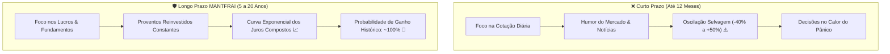

# Aula 2.3 — O Maior Desafio do Investidor: O Domínio da Volatilidade

Esta é, sem sombra de dúvida, **a aula mais transformadora de todo o Módulo de Clareza Mental**. 

Mais de 90% dos investidores que abandonam a Bolsa de Valores com prejuízo não falham porque compraram ativos ruins, mas porque não estavam psicologicamente preparados para o maior teste que o mercado impõe a qualquer ser humano: **a volatilidade de curto prazo**.

Imagine o seguinte cenário: você economizou com dedicação R$ 10.000 e investiu em empresas de primeira linha. Seis meses depois, estoura uma crise internacional ou uma turbulência política, o mercado entra em pânico e você abre o aplicativo e vê seu saldo marcando **R$ 6.500**.

O que o seu cérebro primitivo diz para você fazer?  
*"Venda tudo agora antes que vire pó!"*

Nesta aula, você vai aprender a enxergar a volatilidade sob a ótica dos grandes mestres do investimento e dominar a psicologia necessária para prosperar onde os amadores entram em desespero.

---

## ⚡ 1. Volatilidade NÃO é Risco de Perda Permanente

A primeira confusão fatal cometida pelo mercado financeiro tradicional é tratar **volatilidade** e **risco** como sinônimos:
- **Risco Real:** É a perda definitiva e irreversível do seu capital. Acontece quando você compra uma empresa podre que vai à falência, ou quando você se desespera e vende um ativo bom no fundo do poço da crise.
- **Volatilidade:** É a oscilação natural dos preços no leilão diário da Bolsa. Ela reflete apenas o humor, a euforia e o medo dos milhões de participantes do mercado naquele dia específico.

> 🏢 **A Analogia do Imóvel Físico:**  
> Se você comprar um apartamento de R$ 500.000 para alugar e, no dia seguinte, um vizinho desesperado bater na sua porta oferecendo comprar o seu apartamento por R$ 350.000, você aceitaria a oferta? Você entraria em pânico achando que perdeu R$ 150.000?  
> **Evidentemente não!** Você sabe que o prédio continua de pé, os inquilinos continuam pagando o aluguel no dia 10 e o valor de mercado do imóvel não mudou em nada. Na Bolsa de Valores acontece rigorosamente o mesmo: a cotação é apenas alguém gritando um preço na rua.

---

## 📈 2. A Ilusão de Ótica da Perspectiva Temporal

Olhe para a história das maiores empresas do Brasil (como o Bradesco, a Itaúsa ou a Vale) durante as grandes crises:
- Na crise do Subprime em 2008, as ações dos grandes bancos chegaram a cair **45% em poucos meses**. Quem olhou apenas o gráfico diário sentiu que o mundo ia acabar.
- Porém, quando você afasta o zoom e olha o gráfico de **20 anos**: **mesmo no ponto mais baixo da crise de 2008, o preço da ação ainda era muito superior ao topo histórico de 1998!**
- Quem manteve a calma, continuou recebendo os dividendos e aproveitou a queda para aportar com desconto, viu o patrimônio se multiplicar de forma estrondosa na recuperação dos anos seguintes.

---

## ⏳ 3. A Estatística Inegável: O Tempo Zera o Risco da Renda Variável

Diversos estudos de finanças comportamentais quantitativas analisaram o retorno histórico de carteiras de ações sólidas em diferentes janelas de tempo:

| Horizonte de Investimento | Probabilidade Histórica de Retorno Positivo | Faixa Típica de Oscilação Anualizada |
| :--- | :--- | :--- |
| **1 Dia** | ~50% (Pura roleta russa) | Oscilação aleatória |
| **1 Ano** | ~65% a 70% | Pode variar de **-40% a +60%** |
| **5 Anos** | ~85% a 90% | Retorno converge para os lucros |
| **10 a 20 Anos** | **~99% a 100%** | Risco de perda permanente praticamente nulo |

No curto prazo (1 ano), o preço de uma ação é determinado quase 100% pela especulação e pelas manchetes de jornal. No longo prazo (10 anos ou mais), **o preço de uma ação segue rigorosamente a curva dos lucros líquidos da empresa**. Se o lucro sobe, a cotação e os proventos sobem juntos.

---

## 🧠 4. A Assimetria Psicológica da Dor (Kahneman & Tversky)

Os psicólogos ganhadores do Prêmio Nobel Daniel Kahneman e Amos Tversky comprovaram a existência da **Aversão à Perda**:
- A dor psicológica de ver uma carteira cair R$ 1.000 é **duas a duas vezes e meia mais intensa** do que a alegria de ver a carteira subir R$ 1.000.
- Por conta dessa distorção cognitiva inata do ser humano, investidores não preparados abandonam métodos vencedores no primeiro ciclo de baixa da economia.

---

## 📱 5. Como o App MANTFRAI Blindará Você na Prática

Para que você nunca dependa da sua força de vontade emocional no calor de uma crise, o MANTFRAI Enterprise foi desenhado com arquitetura de contenção:
1. **Onde Aportar (`/onde-aportar`):** O algoritmo Motor RDM inverte a psicologia amadora. Quando uma classe cai de preço, o algoritmo identifica que ela se distanciou da meta e manda você comprar justamente os ativos com desconto. Você compra barato sem hesitar.
2. **Resumo & Radar (`/resumo` e `/radar`):** Em vez de gráficos histéricos de piscar vermelho e verde, nosso painel foca na solidez dos fundamentos (Lucro Líquido, ROE, Payout e Margem Líquida).
3. **Reserva de Emergência (`/reserva-emergencia`):** Garante que você tenha um colchão de segurança 100% líquido em renda fixa, impedindo que você seja forçado a resgatar ações na baixa diante de um imprevisto da vida.

---

## ⚠️ 6. O Mandamento Supremo do Investidor Inteligente

> 🛡️ **Grave esta verdade:** Em dias de euforia, o investidor inteligente mantém os pés no chão. Em dias de pânico e crise, o investidor inteligente **sorri e compra participações de negócios excelentes a preço de liquidação**.

---

## 📊 7. Infográfico: Horizonte Temporal vs Volatilidade

---

## 🎙️ 8. Prompt para Áudio no Google NotebookLM

> **Como gerar o podcast desta aula:**
> 1. Copie o texto desta aula.
> 2. Cole como nova fonte em [notebooklm.google.com](https://notebooklm.google.com/).
> 3. No campo de personalização do *Audio Overview*, cole a instrução abaixo e clique em **Generate**:
> 
> *"Apresentem uma reflexão profunda e inspiradora sobre o maior desafio psicológico de um investidor: lidar com a volatilidade. Expliquem a diferença fundamental entre volatilidade passageira e perda permanente, usem a analogia impecável do prédio e do vizinho desesperado, e demonstrem com dados históricos por que o tempo zera o risco na renda variável. Mostrem como o algoritmo Motor RDM do MANTFRAI transforma as crises em oportunidades automáticas de compra barata."*
