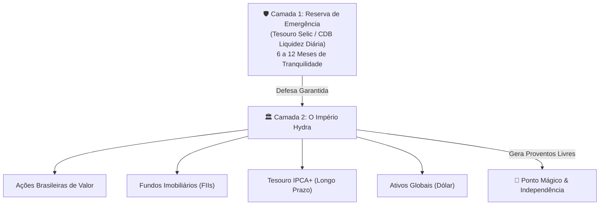

# Aula 3.1 — A Fundação Inegociável: Reserva de Emergência & Renda Fixa

Antes de comprar uma única cota de Fundo Imobiliário ou ação de empresa, existe um mandamento inegociável na metodologia MANTFRAI: **construir a sua trincheira de defesa**.

Investidores que pulam direto para a renda variável sem uma reserva financeira sólida cometem o erro mais comum e destrutivo do mercado: na primeira emergência pessoal (um problema de saúde na família, um conserto inesperado no carro ou uma demissão), eles são **forçados a vender seus ativos na Bolsa**. E pela Lei de Murphy dos mercados, essa emergência quase sempre acontece justamente em um momento de queda temporária das cotações.

Nesta aula, você vai aprender a dimensionar com exatidão a sua Reserva de Emergência, entender as três famílias de Renda Fixa e nunca mais confundir reserva com especulação.

---

## 🛡️ 1. O que é a Reserva de Emergência e Qual o Tamanho Ideal?

A Reserva de Emergência tem uma única e exclusiva função: **comprar a sua paz de espírito**. Ela não foi feita para deixar você rico e não foi feita para render 200% do CDI; ela foi feita para garantir que sua família nunca passe aperto e que seus investimentos de longo prazo nunca precisem ser liquidados às pressas.

### O Cálculo do Tamanho Ideal:
A reserva deve cobrir entre **6 a 12 meses do seu Custo de Vida Básico Mensal** (alimentação, moradia, saúde, transporte e contas fixas):
- **Profissionais com Estabilidade (Concursados / CLT estável):** **6 meses** de custo de vida costumam ser suficientes.
- **Profissionais Autônomos, Empresários e Comissionados:** Devem manter entre **9 a 12 meses**, dada a volatilidade natural da sua receita mensal.

---

## 🏛️ 2. Onde Alocar a Reserva de Emergência?

O tripé obrigatório da Reserva de Emergência é composto por:
1. **Risco Soberano / Mínimo:** Empréstimo para o governo federal ou instituições financeiras de primeira linha.
2. **Liquidez Imediata (D+0 ou D+1):** Capacidade de resgatar o dinheiro no mesmo dia ou no próximo dia útil sem burocracia.
3. **Ausência de Volatilidade Negativa:** O saldo nunca pode amanhecer menor do que no dia anterior.

### Os Veículos Aprovados pelo MANTFRAI:
- ✅ **Tesouro Selic (Tesouro Direto):** O título público mais seguro do país, lastreado pelo Tesouro Nacional, com liquidez diária e rendimento atrelado à taxa básica de juros.
- ✅ **CDB de Liquidez Diária (100% do CDI) de Grandes Bancos:** Garantido pelo FGC (Fundo Garantidor de Créditos) até R$ 250.000 por CPF e por instituição.
- ❌ **Onde NUNCA colocar a reserva:** Fundos imobiliários, ações, debêntures, criptomoedas, títulos prefixados ou CDBs com prazo de resgate travado (ex: "resgate só em 2029").

---

## 📊 3. As Três Famílias da Renda Fixa: Não Confunda as Funções

Nem toda renda fixa serve para a mesma coisa. O mercado divide os títulos em três grandes categorias:

| Família | Como Rende? | Para que Serve? | Sofre Marcação a Mercado? |
| :--- | :--- | :--- | :--- |
| **Pós-Fixada** *(Tesouro Selic / CDB 100% CDI)* | Acompanha a taxa Selic/CDI diariamente. | **Reserva de Emergência e Curto Prazo.** | Não (rende sempre em linha reta para cima). |
| **Indexada à Inflação** *(Tesouro IPCA+)* | Garante uma taxa real fixa + a variação do IPCA. | **Blindagem de Poder de Compra no Longo Prazo.** | **Sim!** Se resgatar antes do vencimento, o preço oscila. No vencimento, recebe 100% do contratado. |
| **Prefixada** *(Tesouro Prefixado / CDB Prefixado)* | Taxa fixa fechada (Ex: 11% ao ano). | **Projetos com data e valor fixo definidos.** | **Sim!** Muito sensível a mudanças na taxa de juros. |

> ⚠️ **Atenção Máxima com a Marcação a Mercado:** Títulos como o *Tesouro IPCA+ 2045* oscilam de preço diariamente como uma ação! Eles são fantásticos para proteger o patrimônio de longo prazo contra a inflação, mas **jamais devem ser usados como reserva de emergência**.

---

## 📱 4. Aplicação Prática no App MANTFRAI

No **MANTFRAI Enterprise**, você tem um módulo exclusivo para gerenciar essa etapa:
1. Acesse o menu **Reserva de Emergência** (`/reserva-emergencia`).
2. Insira o seu **Custo de Vida Básico Mensal** e selecione o seu perfil de estabilidade (6, 9 ou 12 meses).
3. O sistema calcula a sua meta monetária exata e apresenta uma barra de progresso visual de conclusão.
4. Enquanto sua reserva não atingir pelo menos 80% da meta, o algoritmo recomenda priorizar os aportes na defesa antes de avançar agressivamente em renda variável.

---

## ⚠️ 5. O Erro Fatal do Amador

> 🚫 **O Erro:** Achar que deixar dinheiro na reserva de emergência é "perder dinheiro" e colocar tudo na Bolsa para tentar ganhar mais rápido.
> 
> 🛡️ **A Postura MANTFRAI:** A reserva de emergência não é um investimento para maximizar rentabilidade; ela é **o seguro de vida da sua estratégia patrimonial**. Sem ela, você é um castelo de cartas esperando o primeiro vento para desmoronar.

---

## 📊 6. Infográfico: A Hierarquia da Segurança Financeira

---

## 🎙️ 7. Prompt para Áudio no Google NotebookLM

> **Como gerar o podcast desta aula:**
> 1. Copie o texto desta aula.
> 2. Cole como nova fonte em [notebooklm.google.com](https://notebooklm.google.com/).
> 3. No campo de personalização do *Audio Overview*, cole a instrução abaixo e clique em **Generate**:
> 
> *"Apresentem uma aula esclarecedora e muito prática sobre por que a Reserva de Emergência é a fundação inegociável de qualquer investidor de sucesso. Detalhem a fórmula de cálculo (6 a 12 meses de custo de vida), expliquem didaticamente a diferença entre Tesouro Selic, Prefixado e Tesouro IPCA+, alertem sobre os perigos da marcação a mercado para quem não entende o mecanismo, e mostrem como a tela de Reserva de Emergência do MANTFRAI organiza essa proteção."*
