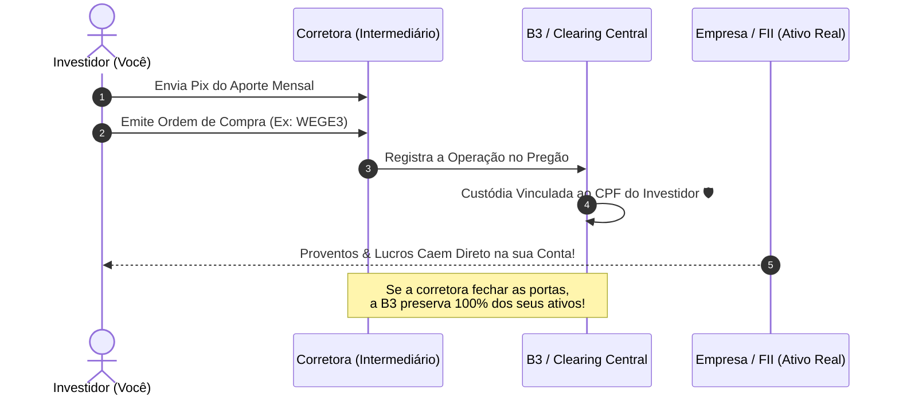

# Aula 3.2 — Estrutura Operacional: Escolha de Corretoras & Custódia B3

Uma das dúvidas mais comuns de quem está dando os primeiros passos no mercado financeiro é:
> *"Qual corretora devo escolher? E se essa corretora falir com todas as minhas ações e títulos públicos lá dentro, eu perco o meu patrimônio?"*

O medo é compreensível para quem está acostumado apenas com a poupança do banco da esquina. No entanto, a infraestrutura do mercado de capitais brasileiro é uma das mais modernas, auditadas e seguras do planeta.

Nesta aula, você vai entender como funciona a **Custódia Centralizada na B3**, os critérios para escolher a corretora ideal sem pagar taxas inúteis e o passo a passo para emitir suas primeiras ordens com tranquilidade.

---

## 🏛️ 1. O Papel Real da Corretora: Uma Ponte, Não um Cofre

Muitos investidores acreditam erroneamente que o dinheiro aplicado em ações ou FIIs fica "dentro" da corretora. Isso é um equívoco:

- **A Corretora é Apenas uma Ponte:** Ela atua meramente como um canal credenciado para conectar você à Bolsa de Valores oficial do Brasil (**B3**) ou ao sistema do **Tesouro Nacional**.
- **A Custódia é Registrada no Seu CPF:** Quando você compra 100 ações da Weg ou 50 cotas de um fundo imobiliário, esses ativos não pertencem à corretora. Eles ficam registrados e blindados em seu nome e CPF na câmara de compensação central da B3 (**Clearing**).

> 🛡️ **O Teste da Falência:** Se a corretora que você utiliza vier a falir amanhã, **você não perde um único centavo das suas ações, FIIs ou títulos públicos**. Você simplesmente entra no portal do investidor da B3 ou solicita a transferência de custódia (STVM) para qualquer outra corretora de sua preferência. O patrimônio é e sempre será seu.

---

## 🔍 2. Critérios de Ouro para Selecionar sua Corretora

Não caia no conto de corretoras que cobram taxas abusivas por serviços básicos. Para aplicar a metodologia MANTFRAI, sua corretora deve atender rigorosamente a estes requisitos:

1. **Corretagem Zero para Ações e FIIs:** Você não deve pagar R$ 10, R$ 15 ou R$ 20 cada vez que executar um aporte mensal. Quase todas as grandes corretoras do país hoje oferecem corretagem zero.
2. **Taxa Zero de Custódia:** Nenhuma cobrança mensal apenas para manter seus títulos guardados.
3. **Estabilidade e Solidez:** Instituições com boa governança e plataformas funcionais (exemplos consolidados no mercado brasileiro: BTG Pactual, XP Investimentos, Rico, Toro, NuInvest/Nubank, Banco Inter).
4. **Facilidade Operacional:** Aplicativo limpo e intuitivo para compra de frações e lotes sem complicação.

---

## 🎯 3. Como Comprar um Ativo: Ordem a Mercado vs Ordem Limitada

Ao abrir o aplicativo da sua corretora e buscar o código de um ativo (por exemplo, `EGIE3` ou `HGLG11`), você encontrará duas formas principais de enviar a ordem:

- **Ordem Limitada (Recomendada):** Você determina o preço máximo exato que aceita pagar (ex: *"Quero comprar a no máximo R$ 42,50"*). A ordem só é executada se o mercado negociar naquele valor ou abaixo dele. É a opção mais segura para evitar surpresas em oscilações momentâneas.
- **Ordem a Mercado:** Executa imediatamente no melhor preço que o vendedor do outro lado estiver oferecendo. Útil para compras rápidas de ativos com altíssima liquidez diária.

---

## 📱 4. Aplicação Prática no App MANTFRAI

No **MANTFRAI Enterprise**, você unifica toda a sua inteligência patrimonial em um único lugar:
1. **Lançamento Rápido de Transações:** No painel lateral ou no menu **Histórico** (`/historico`), clique em `+ Nova Transação` para registrar suas compras e proventos com precisão monetária de centavos.
2. **Calculadora Inteligente de Preço Médio:** O sistema recalcula automaticamente a sua posição consolidada e seu preço médio real.
3. **Privacidade e Segurança:** Seus dados ficam protegidos no seu ambiente seguro, sem exposição de credenciais bancárias.

---

## ⚠️ 5. O Erro Fatal do Amador

> 🚫 **O Erro:** Deixar dinheiro parado sem render no saldo da conta corrente da corretora por semanas a fio enquanto espera uma "dica de ouro".
> 
> 🛡️ **A Postura MANTFRAI:** A corretora é apenas a estrada de passagem. Transferiu o dinheiro via Pix? Execute imediatamente o aporte indicado pelo **Motor RDM** ou aplique no Tesouro Selic. Dinheiro parado na conta corrente da corretora não rende juros e não tem garantia da B3.

---

## 📊 6. Infográfico: O Fluxo de Segurança da Custódia B3

---

## 🎙️ 7. Prompt para Áudio no Google NotebookLM

> **Como gerar o podcast desta aula:**
> 1. Copie o texto desta aula.
> 2. Cole como nova fonte em [notebooklm.google.com](https://notebooklm.google.com/).
> 3. No campo de personalização do *Audio Overview*, cole a instrução abaixo e clique em **Generate**:
> 
> *"Gravem uma conversa prática, descomplicada e muito encorajadora para desmistificar o funcionamento de uma corretora de investimentos. Expliquem como a custódia centralizada na B3 protege o investidor mesmo em caso de falência da instituição financeira, citem os critérios inegociáveis para escolher uma corretora sem taxa de corretagem, e demonstrem a simplicidade de emitir uma ordem de compra na prática com o apoio do MANTFRAI."*
