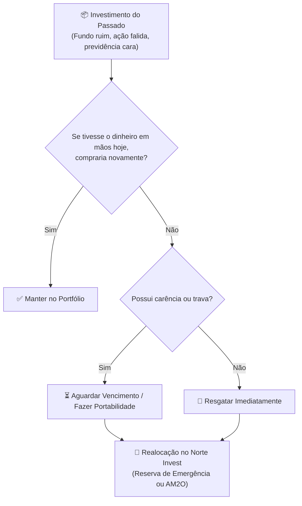

# Aula 3.3 — Faxina Financeira: O que Fazer com Investimentos Ruins

Quase todo mundo que chega ao Norte Invest não começa com uma folha em branco. É extremamente comum carregar na bagagem investimentos antigos contratados por impulso ou por recomendação enviesada de gerentes de banco:
- Títulos de capitalização disfarçados de investimento.
- Planos de previdência privada (PGBL/VGBL) com taxas de carregamento abusivas e fundos medíocres que perdem do CDI.
- COEs (*Certificados de Operações Estruturadas*) com capital protegido, mas retorno financeiro pífio.
- Ações de empresas deficitárias que despencaram 80% ou fundos imobiliários problemáticos que deixaram de pagar dividendos.

E a grande dúvida que consome o investidor é sempre a mesma:  
> *"Devo aceitar o prejuízo e vender agora, ou devo esperar o ativo voltar para o preço que eu paguei para poder sair sem perder dinheiro?"*

Nesta aula, você vai aprender a superar a armadilha do **Custo Afundado** e executar um plano metódico de faxina financeira para liberar o seu capital rumo aos ativos de verdadeiro valor.

---

## ⚓ 1. A Armadilha Psicológica do "Custo Afundado" (*Sunk Cost*)

Na economia comportamental, a falácia do custo afundado ocorre quando insistimos em um erro do passado simplesmente porque já gastamos tempo ou dinheiro nele.

Pense comigo:
- Você compra um ingresso para assistir a um filme no cinema. Aos 20 minutos de exibição, você percebe que o filme é horrível, monótono e sem sentido.
- Faz algum sentido você continuar sentado na poltrona sofrendo por mais duas horas só porque já pagou pelo ingresso? **Claro que não!** O dinheiro do ingresso já foi embora; continuar na sala só faz você perder mais duas horas preciosas da sua vida.

Nos investimentos é exatamente igual:
> 🚫 **O Erro Fatal:** *"Vou esperar essa ação voltar para R$ 20,00 para sair no zero a zero."*  
> O mercado não sabe e não se importa pelo preço que você comprou. Uma empresa ruim com dívidas impagáveis pode levar 20 anos para se recuperar — ou, o que é muito mais provável, ir à falência definitiva. Enquanto você fica esperando sentado, o seu dinheiro está deixando de render dividendos nas melhores empresas do país.

---

## 🔍 2. O Teste Supremo da Decisão Racional

Para saber se você deve manter ou encerrar qualquer investimento do seu passado, faça a si mesmo uma única pergunta sincera:

> 💡 **A Pergunta de Ouro:** *"Se eu acordasse hoje de manhã com esse mesmo valor creditado em dinheiro vivo na minha conta corrente, **eu usaria esse dinheiro para comprar esse mesmo produto novamente?**"*

- Se a resposta for **NÃO**, não existe justificativa matemática ou lógica para você continuar com esse produto por mais um dia sequer. Manter um ativo ruim é exatamente igual a comprá-lo todos os dias de novo pelo preço de mercado.

---

## 📋 3. As Três Regras para a Transição Inteligente

Antes de sair clicando no botão de resgate em tudo, execute a sua faxina seguindo este roteiro ordenado:

### Regra 1: Classifique os Ativos Ruins por Liquidez
- **Ativos de Liquidez Imediata (Fundos ruins, CDBs vencidos, ações sem fundamentos):** Resgate imediatamente e direcione o capital para a sua Reserva de Emergência ou para o algoritmo AM2O.
- **Ativos Travados com Prazo (CDBs longos sem liquidez, LCIs):** Se houver penalidade severa para resgate antecipado, aguarde a data de vencimento natural. Assim que o dinheiro cair na conta, migre para ativos da metodologia.

### Regra 2: Portabilidade de Previdência Privada
Se você tem um plano de previdência privada em um bancão tradicional com taxas abusivas, **você não precisa resgatar e pagar imposto de renda antecipado**.
- Você pode solicitar a **Portabilidade Gratuita** para um fundo de previdência moderno com taxa zero de carregamento e gestão passiva em títulos do Tesouro IPCA+ ou ações de valor.

### Regra 3: Compensação Tributária de Prejuízos em Renda Variável
Se você vendeu ações com prejuízo na Bolsa, guarde esse valor! Pela legislação fiscal brasileira, **prejuízos acumulados em ações podem ser abatidos indefinidamente** de lucros futuros em operações de mesma natureza para economizar imposto de renda.

---

## 📱 4. Aplicação Prática no App Norte Invest

No **Norte Invest V2 Enterprise**, você limpa a sua carteira em poucos passos:
1. Acesse o menu **Carteira** (`/carteira`).
2. Identifique os ativos que não atendem mais aos critérios do Método DAVI.
3. Lance as vendas no botão `+ Nova Transação` no `/historico`.
4. Ao receber o valor líquido, abra a tela **Onde Aportar** (`/onde-aportar`) e permita que o algoritmo redistribua o capital nos ativos saudáveis que estão mais descontados no momento.

---

## ⚠️ 5. O Erro Fatal do Amador

> 🚫 **O Erro:** Ter vergonha de reconhecer um erro do passado e esconder investimentos ruins embaixo do tapete para fingir que não perdeu dinheiro.
> 
> 🛡️ **A Postura Norte Invest:** Todo investidor experiente já comprou um ativo errado na vida. A diferença é que o investidor inteligente corrige o curso rápido, estanca a sangria e põe o dinheiro para trabalhar onde há futuro e lucros reais.

---

## 📊 6. Infográfico: O Fluxo da Faxina Patrimonial

---

## 🎙️ 7. Prompt para Áudio no Google NotebookLM

> **Como gerar o podcast desta aula:**
> 1. Copie o texto desta aula.
> 2. Cole como nova fonte em [notebooklm.google.com](https://notebooklm.google.com/).
> 3. No campo de personalização do *Audio Overview*, cole a instrução abaixo e clique em **Generate**:
> 
> *"Apresentem uma aula libertadora e prática sobre como fazer uma verdadeira faxina financeira na carteira de investimentos. Expliquem a falácia psicológica do custo afundado com a metáfora brilhante do cinema, ensinem o Teste de Ouro para decidir se vale a pena vender com prejuízo, e passem o plano passo a passo para se livrar de previdências ruins, títulos de capitalização e ações podres, realocando o capital nos motores de dividendos do Norte Invest."*
