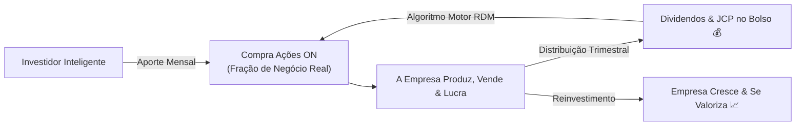

# Aula 4.1 — O que São e Como Funcionam as Ações

Bem-vindo ao coração do Método MANTFRAI. A partir deste módulo, você aprenderá a técnica refinada para garimpar as empresas mais lucrativas e resilientes do país.

Para a maioria das pessoas que assiste aos jornais sensacionalistas, uma "ação" é vista como uma linha que sobe e desce na tela, uma aposta de cassino onde você tenta comprar por 10 para revender por 12 na semana que vem.

Essa mentalidade de especulador de curto prazo é a causa de 95% dos prejuízos na Bolsa de Valores. Nesta aula, vamos resgatar a verdadeira essência do mercado de capitais: **a mentalidade de sócio de grandes impérios empresariais**.

---

## 🏭 1. Ação é um Pedaço de uma Empresa Real

Quando você compra uma ação (por exemplo, `WEGE3`, `ITUB4` ou `EGIE3`), você não está comprando um papel ou um código alfanumérico. 

Você está adquirindo **uma fração patrimonial e jurídica de um negócio real**:
- Com fábricas físicas, escritórios, frotas, patentes e computadores.
- Com milhares de colaboradores trabalhando todos os dias para desenvolver produtos e atender clientes.
- Com contratos comerciais assinados e faturamento diário caindo no caixa.

Se a empresa vende mais motores elétricos, abre novas agências ou gera mais energia hidrelétrica e apura um lucro bilionário no trimestre, **você, como acionista e sócio, é o dono legítimo de uma fatia proporcional desse lucro**.

---

## 🎟️ 2. Ações ON (Ordinárias) vs Ações PN (Preferenciais)

Ao navegar pelo mercado acionário brasileiro, você notará números no final dos códigos das ações:

| Tipo | Código Típico | Características Principais | Recomendação MANTFRAI |
| :--- | :--- | :--- | :--- |
| **ON (Ordinária)** | Final **3** (Ex: `WEGE3`, `VALE3`) | Dá direito a voto nas assembleias e garante **alinhamento total com o controlador**. Se o controlador vender a empresa, você tem direito ao mesmo tratamento. | ✅ **Preferência Absoluta** (Padrão Novo Mercado). |
| **PN (Preferencial)** | Final **4** (Ex: `ITUB4`, `PETR4`) | Não dá direito a voto, mas dá prioridade no recebimento de dividendos. | Aceitável em empresas históricas com excelente governança e liquidez. |
| **Units** | Final **11** (Ex: `SAPR11`, `KLBN11`) | Pacote combinado contendo ações ON e PN juntas. | Aceitável dependendo da governança do ativo. |

> 🛡️ **O Padrão MANTFRAI:** Sempre que possível, priorizamos ações **Ordinárias (ON - final 3)** ou empresas listadas no **Novo Mercado**, garantindo que estejamos sentados exatamente no mesmo barco dos donos controladores.

---

## 💰 3. As Duas Formas de Lucrar com Ações

Ao se tornar sócio de negócios lucrativos, o retorno retorna para o seu bolso através de:

1. **Proventos em Dinheiro:**
   - **Dividendos:** Distribuição direta do lucro líquido isenta de imposto de renda para a pessoa física.
   - **Juros sobre Capital Próprio (JCP):** Remuneração aos acionistas com retenção na fonte de 15%, caindo líquido na sua conta da corretora.
2. **Valorização Patrimonial:** À medida que a empresa reinveste parte dos lucros para construir novas fábricas e aumentar seu faturamento, o valor intrínseco do negócio cresce, empurrando as cotações para cima no longo prazo.

---

## 📱 4. Aplicação Prática no App MANTFRAI

No **MANTFRAI Enterprise**, você acompanha suas ações com foco nos fundamentos:
1. Acesse o **Radar de Ativos** (`/radar`) e selecione a aba **Ações**.
2. Note que cada ativo exibe o setor perene, a governança corporativa e os indicadores fundamentais de retorno.
3. No menu **Renda Passiva** (`/renda-passiva`), veja o calendário estimado e a previsão de proventos que suas empresas depositarão na sua conta.

---

## ⚠️ 5. O Erro Fatal do Amador

> 🚫 **O Erro:** Ficar acompanhando o "home broker" minuto a minuto, comemorando quando a ação sobe 2% e sofrendo quando cai 2%.
> 
> 🛡️ **A Postura MANTFRAI:** Donos de empresas não fecham e abrem seu comércio de cinco em cinco minutos para ver quanto ele vale. Nós olhamos balanços trimestrais e anuais. Se os lucros continuam crescendo, o trabalho do investidor inteligente é apenas continuar comprando mais participações pelo algoritmo Motor RDM.

---

## 📊 6. Infográfico: A Mentalidade de Sócio

---

## 🎙️ 7. Prompt para Áudio no Google NotebookLM

> **Como gerar o podcast desta aula:**
> 1. Copie o texto desta aula.
> 2. Cole como nova fonte em [notebooklm.google.com](https://notebooklm.google.com/).
> 3. No campo de personalização do *Audio Overview*, cole a instrução abaixo e clique em **Generate**:
> 
> *"Apresentem uma aula empolgante e desmistificadora sobre o que significa de verdade possuir ações na Bolsa de Valores. Contrastem com humor e perspicácia a loucura do especulador que olha gráficos o dia inteiro com a serenidade do sócio que investe na economia real. Expliquem a diferença entre ações ON e PN e reforcem por que o MANTFRAI prioriza o alinhamento societário e o fluxo de dividendos."*
