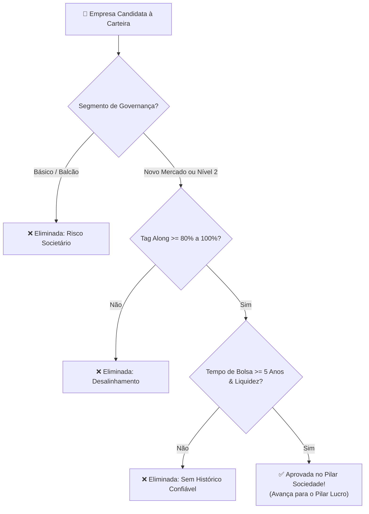

# Aula 4.2 — Fundamentos das Ações I: Sociedade, Governança & Tag Along

Imagine que você decidiu abrir uma padaria em sociedade com um conhecido da sua cidade. A padaria fatura muito bem, vende milhares de pães todos os dias e tem filas na porta. 

Porém, o seu sócio administra o caixa, contrata parentes com salários exorbitantes para cargos que não existem, desvia receitas para contas pessoais e mente nas reuniões sobre as despesas reais. 

Qual será o resultado dessa sociedade? **Você será lesado e perderá o seu dinheiro**, por mais lucrativa que a padaria pudesse ser no papel.

Na Bolsa de Valores a dinâmica é idêntica. É por isso que no Método DAVI nós **nunca começamos olhando gráficos ou lucros**. Nós começamos sempre pelo primeiro e mais inegociável fundamento: **a idoneidade e o alinhamento da Sociedade**.

---

## 🏛️ 1. Os Segmentos de Listagem da B3: A Escala de Transparência

A Bolsa de Valores brasileira divide as empresas em diferentes "prateleiras" de governança corporativa. O investidor inteligente só coloca os pés onde os direitos dos sócios minoritários são respeitados por contrato:

| Segmento B3 | Nível de Proteção | Regras Principais | Aprovação Norte Invest |
| :--- | :--- | :--- | :--- |
| **Novo Mercado** | 🥇 **Padrão Ouro Máximo** | Apenas ações ON (100% alinhamento, uma ação = um voto); **Tag Along de 100% obrigatório**; mínimo de 20% de conselheiros independentes; comitê de auditoria obrigatório. | ✅ **Recomendação Prioritária** |
| **Nível 2** | 🥈 Alto | Permite emissão de ações PN, mas exige Tag Along de 100% para ações ON e PN, além de relatórios contábeis internacionais (IFRS). | ✅ **Aprovado com Ressalvas** |
| **Nível 1** | 🥉 Médio | Exige maior divulgação de informações trimestrais, mas não garante Tag Along de 100%. | ⚠️ **Análise Crítica Estrita** |
| **Básico / Balcão** | ❌ Baixo | Regras mínimas da Lei das S/A (Tag Along mínimo de 80% só para ON). Risco elevado para o minoritário. | 🚫 **Eliminado pelo Método DAVI** |

---

## 🛡️ 2. O que é Tag Along e por que ele Salva o seu Patrimônio?

O **Tag Along** (ou Direito de Saída Conjunta) é a garantia jurídica de que você, pequeno investidor, não será deixado para trás se o controle da empresa for vendido.

### O Caso Prático:
- Imagine que você possui 1.000 ações da Empresa X, cotadas em Bolsa a R$ 20,00.
- Um grande conglomerado internacional decide comprar a empresa e oferece **R$ 50,00 por ação** diretamente aos donos fundadores controladores.
- **Se a empresa possui 100% de Tag Along:** Por lei, o comprador é obrigado a fazer uma oferta pública (OPA) e pagar **os mesmos R$ 50,00 por ação** a você! Você embolsa uma valorização espetacular de 150%.
- **Se a empresa NÃO possui Tag Along:** O controlador embolsa R$ 50,00, vai embora para o Caribe com o bolso cheio, e um novo gestor desconhecido assume a empresa. As suas ações na Bolsa podem despencar para R$ 10,00 e você fica de mãos atadas sem ter a quem recorrer.

> 🔒 **Regra de Ouro:** Exigimos **Tag Along de 100%** (ou no mínimo 80% em casos históricos consolidados). Minoritário inteligente não aceita ser cidadão de segunda classe na Bolsa.

---

## ⏳ 3. Tempo de Listagem & Liquidez Mínima

Para garantir que a governança não seja apenas uma fachada de marketing, o Método DAVI aplica mais dois critérios eliminatórios:

1. **Tempo de Bolsa (Mínimo de 5 Anos):** Fugimos de IPOs recentes (ofertas públicas inaugurais). Quem abre capital costuma "maquiar a noiva" para vender caro. Queremos empresas que já estejam sob o escrutínio público há pelo menos meia década.
2. **Liquidez Financeira Diária (Mínimo de R$ 1 Milhão/dia):** Garante que você possa comprar frações ou lotes e resgatar quando quiser sem travar o mercado e sem sofrer com distorções de preço (spread alto).

---

## 📱 4. Aplicação Prática no App Norte Invest

No **Norte Invest V2 Enterprise**, todo esse trabalho investigativo já vem pronto:
1. Abra o **Radar de Ativos** (`/radar`).
2. Ao clicar em qualquer ação (ex: `WEGE3`, `EGIE3`, `BBAS3`), veja os selos de **Governança (Novo Mercado)**, **Tag Along (100%)** e o volume financeiro diário.
3. Se um ativo não cumpre esses critérios, o sistema emite um alerta de segurança visual.

---

## ⚠️ 5. O Erro Fatal do Amador

> 🚫 **O Erro:** Comprar ações de empresas com histórico de escândalos de corrupção, fraudes contábeis ou brigas societárias na justiça só porque a cotação "parece barata".
> 
> 🛡️ **A Postura Norte Invest:** Quem se associa a maus sócios colhe maus frutos. Caráter, governança e respeito aos minoritários vêm antes de qualquer múltiplo de preço.

---

## 📊 6. Infográfico: O Filtro da Sociedade

---

## 🎙️ 7. Prompt para Áudio no Google NotebookLM

> **Como gerar o podcast desta aula:**
> 1. Copie o texto desta aula.
> 2. Cole como nova fonte em [notebooklm.google.com](https://notebooklm.google.com/).
> 3. No campo de personalização do *Audio Overview*, cole a instrução abaixo e clique em **Generate**:
> 
> *"Produzam uma conversa envolvente e didática sobre a importância da governança e do alinhamento societário na Bolsa de Valores. Usem a analogia da sociedade na padaria para demonstrar o perigo de ter sócios desonestos, expliquem com clareza o mecanismo do Tag Along de 100% e por que o selo Novo Mercado da B3 é o primeiro filtro inegociável do Método DAVI do Norte Invest."*
