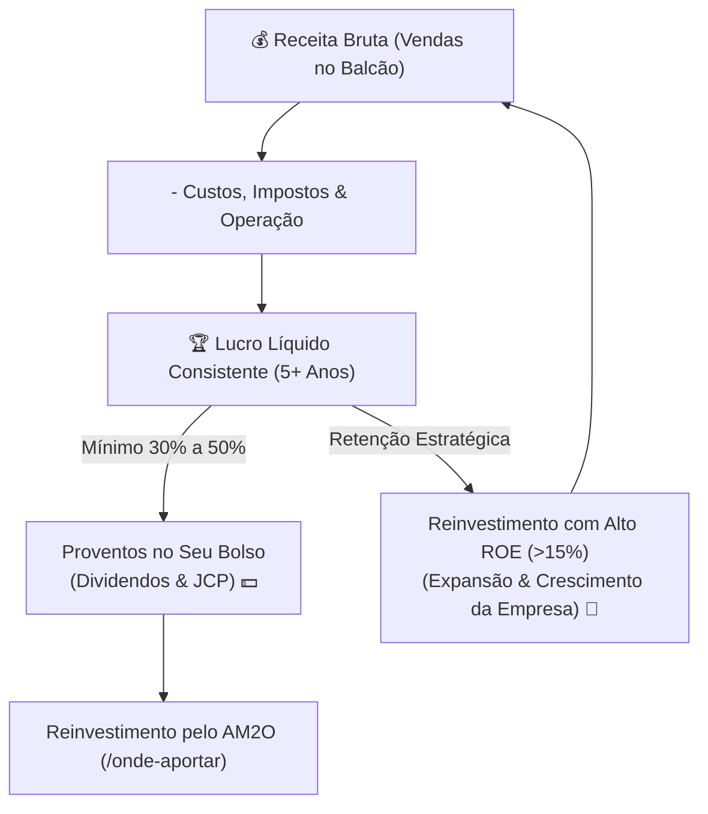

# Aula 4.3 — Fundamentos das Ações II: Lucro Consistente, Margem & ROE

Existe uma frase célebre no ambiente empresarial que resume com perfeição o valor de uma companhia:
> *"Faturamento é vaidade, Lucro é sanidade, e Caixa é a pura realidade."*

Muitos investidores amadores se deixam encantar por empresas que estampam capas de revistas de negócios porque "faturaram 10 bilhões de reais no ano" ou porque têm milhões de usuários cadastrados em seus aplicativos. 

No entanto, quando você abre a última linha da demonstração contábil (a DRE), descobre que a empresa gastou 11 bilhões para faturar 10, fechando o ano com um **prejuízo estarrecedor de 1 bilhão**.

Nesta aula, você aprenderá por que o **Lucro Líquido Consistente** é o único oxigênio verdadeiro capaz de sustentar as cotações e pagar proventos na sua conta corrente ao longo das décadas.

---

## 🌬️ 1. O Lucro como Oxigênio dos Dividendos

Pense de forma simples e pragmática: de onde vem o dividendo que cai na sua conta da corretora no dia 15 do mês?
- O dividendo não é mágica, não é bônus governamental e não é doação da diretoria.
- O dividendo é **uma fatia do lucro líquido real** que sobrou no caixa da empresa após pagar todos os salários, fornecedores, impostos e custos operacionais.

Se uma empresa dá prejuízo sistemático, só existem duas maneiras de ela continuar funcionando:
1. **Pegar empréstimos bancários:** Aumentando as dívidas até virar uma bola de neve impagável.
2. **Emitir novas ações (Follow-on / Diluição):** Vendendo mais cotas na Bolsa e diminuindo a sua porcentagem de dono no negócio.

> 🚫 **Critério Eliminatório do Método DAVI:** Empresa que apresentou prejuízo líquido nos últimos 5 anos é **sumariamente eliminada da nossa lista de compras**. Nós não somos investidores de esperança; somos investidores de resultados comprovados.

---

## 🎯 2. A Tríade da Eficiência: Lucro, Margem e ROE

Para avaliar se uma empresa transforma receitas em riqueza de forma espetacular, o Método DAVI examina três indicadores fundamentais:

### 1. Consistência e Crescimento de Lucros (CAGR)
Não basta a empresa ter dado um lucro esporádico ontem por ter vendido um terreno ou uma filial. Queremos ver uma **escadinha de lucros consistentes** nos últimos 5 e 10 anos. Se a economia passa por recessão, a grande empresa mantém seus lucros resilientes.

### 2. Margem Líquida (O Poder de Precificação)
A Margem Líquida mede quantos centavos de lucro limpo a empresa retém para cada R$ 1,00 que fatura:
$$\text{Margem Líquida} = \frac{\text{Lucro Líquido}}{\text{Receita Líquida}} \times 100$$
- Empresas com **Margem Líquida acima de 10% a 15%** possuem aquilo que Warren Buffett chama de "fosso econômico" (*moat*): marcas fortes, produtos indispensáveis e capacidade de repassar aumentos de custos da inflação para os clientes sem perder vendas.

### 3. ROE — Return on Equity (Retorno sobre o Patrimônio Líquido)
O ROE mede a capacidade dos executivos de multiplicar o próprio dinheiro dos sócios:
$$\text{ROE} = \frac{\text{Lucro Líquido}}{\text{Patrimônio Líquido}} \times 100$$
- Se a taxa básica de juros do país (Selic) está em 10% ao ano, não faz sentido ser sócio de uma empresa que tenha um ROE de apenas 5% (ela rende menos do que o Tesouro Nacional livre de risco!).
- No Norte Invest, priorizamos empresas com **ROE historicamente acima de 12% a 15%**, demonstrando máquinas de alta rentabilidade.

---

## 📱 3. Aplicação Prática no App Norte Invest

No **Norte Invest V2 Enterprise**, você não precisa fazer contas manuais de balanços:
1. Acesse o **Radar de Ativos** (`/radar`).
2. Observe a coluna de **ROE**, **Margem** e a evolução dos lucros nos cards detalhados.
3. Filtre facilmente os papéis com os melhores múltiplos operacionais do mercado brasileiro em um único clique.

---

## ⚠️ 4. O Erro Fatal do Amador

> 🚫 **O Erro:** Comprar ações de empresas que estão há anos no vermelho esperando um "turnaround" (uma reviravolta milagrosa).
> 
> 🛡️ **A Postura Norte Invest:** A probabilidade histórica de uma empresa cronicamente deficitária se recuperar é inferior a 5%. Nós preferimos a certeza de ser sócios de campeãs comprovadas que lucram todos os dias.

---

## 📊 5. Infográfico: O Motor da Riqueza Empresarial

---

## 🎙️ 6. Prompt para Áudio no Google NotebookLM

> **Como gerar o podcast desta aula:**
> 1. Copie o texto desta aula.
> 2. Cole como nova fonte em [notebooklm.google.com](https://notebooklm.google.com/).
> 3. No campo de personalização do *Audio Overview*, cole a instrução abaixo e clique em **Generate**:
> 
> *"Produzam uma aula técnica e extremamente acessível sobre o fundamento mais importante de uma ação: o lucro consistente. Usem a célebre máxima 'faturamento é vaidade, lucro é sanidade' para criticar a armadilha de comprar empresas deficitárias da moda, detalhem o significado prático do ROE e da Margem Líquida com exemplos simples, e mostrem como o Radar de Ativos do Norte Invest filtra apenas as empresas que são verdadeiras máquinas de gerar caixa."*
