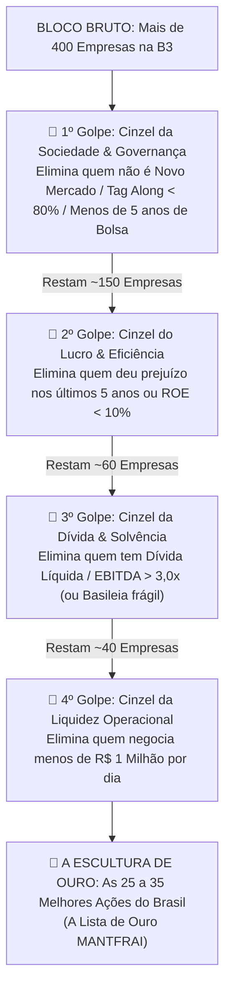

# Aula 4.5 — O Filtro MFS na Prática: A Escultura de Michelangelo

Conta a história da arte renascentista que, no início do século XVI, a catedral de Florença encomendou uma estátua monumental a partir de um bloco gigantesco de mármore de Carrara. Diversos escultores renomados tentaram trabalhar a pedra, mas desistiram após danificá-la, declarando que o mármore era imperfeito e inútil.

O bloco ficou abandonado na chuva por quase quarenta anos, até que o jovem gênio **Michelangelo Buonarroti** o assumiu. Com meses de trabalho obstinado, ele esculpiu uma das obras mais perfeitas e admiradas da história da humanidade: **a estátua de Davi**.

Quando os nobres de Florença, maravilhados com a perfeição dos músculos, veias e expressão da estátua, perguntaram a Michelangelo como ele havia sido capaz de conceber tanta perfeição a partir de uma pedra considerada imprestável, o mestre respondeu com simplicidade desconcertante:

> 🗿 *"Davi sempre esteve ali dentro do mármore desde o primeiro dia. Eu não criei nada de novo; eu apenas peguei o cinzel e **retirei tudo aquilo que não era Davi**."*

---

## 🏛️ 1. O Princípio da Eliminação Aplicado à Bolsa de Valores

No mercado de capitais brasileiro existem mais de **400 empresas listadas** na B3:
- Se você for agir como o investidor amador, tentará acompanhar dezenas de canais de notícias, ler centenas de relatórios de analistas e especular qual das 400 vai subir amanhã. O resultado é confusão mental, ansiedade e perda de dinheiro.
- A maioria esmagadora dessas 400 empresas são negócios medíocres, estatais aparelhadas politicamente, empresas afundadas em dívidas impagáveis ou companhias controladas por famílias que não respeitam os acionistas minoritários.

O **Filtro MFS** faz exatamente o mesmo que Michelangelo fez com o mármore bruto: nós não procuramos uma "agulha no palheiro". Nós simplesmente passamos os **cinzéis eliminatórios sucessivos** para descartar tudo o que é ruído.

O que sobra após os cortes não é uma aposta: **é a verdadeira obra de arte do seu patrimônio**.

---

## 🔨 2. Os Quatro Golpes do Cinzel MFS

Veja como o filtro funciona de forma implacável e matemática:

---

## 💎 3. O que Resta no Bloco: A "Lista de Ouro"

Ao final desse processo rigoroso de eliminação, restam entre **25 a 35 empresas de classe mundial**:
- São companhias que sobrevivem e lucram faça chuva ou faça sol.
- Pagam proventos ininterruptos ano após ano.
- Possuem caixa reforçado, margens altas e marcas indispensáveis na vida dos brasileiros (Itaú, Weg, Engie, Taesa, BB Seguridade, Klabin, etc.).

Quando você compra qualquer uma das empresas aprovadas na Lista de Ouro do Filtro MFS, você sabe que não precisa torcer para o mercado subir. O lucro e a eficiência operacional já estão garantidos pelo rigor da seleção prévia.

---

## 💻 4. Do Excel ao App MANTFRAI V2 Enterprise

No modelo antigo ensinado nas mentorias presenciais, o investidor precisava baixar planilhas pesadas de Excel, puxar dados de sites e calcular fórmulas manuais todos os meses.

No **MANTFRAI Enterprise**, essa trabalheira manual foi completamente eliminada:
- O motor de negócios (`src/server/engines/davi-hydra.engine.ts`) aplica todos os filtros do Filtro MFS em tempo real.
- O painel **Radar de Ativos** (`/radar`) já exibe os papéis devidamente auditados e classificados por qualidade fundamentalista.
- O algoritmo **Motor RDM** (`/onde-aportar`) se encarrega de apontar qual dessas empresas aprovadas está com o preço mais atrativo no dia do seu aporte.

---

## ⚠️ 5. O Erro Fatal do Amador

> 🚫 **O Erro:** Ficar com pena de eliminar uma empresa querida pelo público porque ela tem uma história bonita ou porque o pai do investidor já teve ações dela nos anos 80.
> 
> 🛡️ **A Postura MANTFRAI:** O cinzel do Filtro MFS não tem sentimentos. Se a empresa deu prejuízo ou se endividou além da conta, ela é removida sem hesitação. A integridade do seu patrimônio familiar vem sempre em primeiro lugar.

---

## 🎙️ 6. Prompt para Áudio no Google NotebookLM

> **Como gerar o podcast desta aula:**
> 1. Copie o texto desta aula.
> 2. Cole como nova fonte em [notebooklm.google.com](https://notebooklm.google.com/).
> 3. No campo de personalização do *Audio Overview*, cole a instrução abaixo e clique em **Generate**:
> 
> *"Apresentem uma aula memorável e inspiradora sobre a filosofia do Filtro MFS. Contem a história da estátua de Davi de Michelangelo e usem a metáfora do cinzel que retira tudo o que não presta no bloco de mármore para explicar a seleção de ações na Bolsa de Valores. Demonstrem como os filtros sucessivos reduzem 400 empresas a uma seleta Lista de Ouro de companhias ultra-lucrativas e mostrem como o aplicativo MANTFRAI automatizou todo esse processo."*
