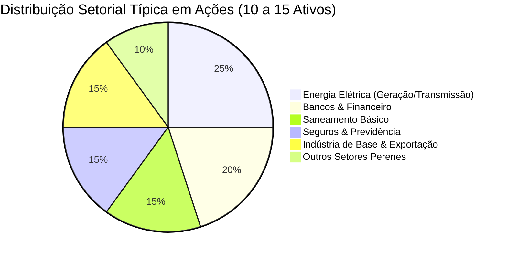

# Aula 4.6 — Análise Individual de Ações: O Checklist Definitivo

Após passar pelo cinzel do Método DAVI e reduzir o universo da B3 às empresas que compõem a Lista de Ouro, você chega à etapa final da seleção de ações: **a análise individual e a escolha dos ativos que farão parte da sua carteira pessoal**.

Quantas ações devo ter? Posso ter apenas duas empresas? Como saber se estou diversificando de forma segura sem pulverizar o patrimônio a ponto de perder o controle?

Nesta aula prática, você terá acesso ao checklist definitivo de 5 etapas para auditar qualquer empresa e às regras matemáticas de distribuição para montar a ala de ações da sua Carteira Hydra.

---

## 📋 1. O Checklist Definitivo do Método DAVI

Antes de dar a ordem de compra para uma nova empresa e adicioná-la à sua carteira, passe o ativo por este crivo de cinco perguntas fundamentais:

| Etapa da Análise | Pergunta Crítica | Critério de Aprovação |
| :--- | :--- | :--- |
| **1. O Negócio & Setor** | O produto ou serviço é perene e indispensável na sociedade? | Pertence aos setores **BEST** ou possui forte fosso competitivo (*moat*). |
| **2. Governança & Sociedade** | Seus direitos como sócio minoritário estão 100% blindados? | Listada no **Novo Mercado** com **Tag Along de 100%** e sem escândalos recentes. |
| **3. Lucratividade Histórica** | A empresa gera caixa limpo e consistente ano após ano? | **5 anos ininterruptos de Lucro Líquido**, com **ROE > 12%** e **Margem > 10%**. |
| **4. Solvência & Dívida** | A empresa aguenta uma recessão com taxa de juros alta? | **Dívida Líquida / EBITDA < 2,5x a 3,0x** (ou Basileia > 14% para bancos). |
| **5. Política de Proventos** | A empresa remunera os acionistas com inteligência? | Payout equilibrado (30% a 70%), distribuindo lucros sem comprometer o crescimento. |

---

## 🎯 2. Quantas Ações Ter na Carteira? (A Regra dos 10 a 15 Ativos)

Um dos erros mais comuns de iniciantes é a **bipolaridade da concentração**:
- Ou concentram todo o patrimônio em apenas 2 empresas (se uma delas sofrer uma fraude contábil, metade da riqueza vai para o ralo).
- Ou compram 60 empresas diferentes (pulverização desnecessária, tornando o acompanhamento inviável e destruindo a rentabilidade).

> ⚖️ **A Regra de Ouro Norte Invest:** A ala de ações da sua Carteira Hydra deve conter entre **10 a 15 empresas excelentes**, distribuídas em setores diferentes da economia:
> - **Teto por Ação Individual:** Nenhuma ação individual deve representar mais do que **8% a 10%** do seu total investido em ações.
> - **Diversificação Setorial:** Nunca tenha mais de 2 empresas do mesmo setor. Combine bancos, elétricas, saneamento, seguros e indústrias essenciais.

---

## 📱 3. Aplicação Prática no App Norte Invest

No **Norte Invest V2 Enterprise**, você adiciona e acompanha sua seleção com total controle:
1. Abra o **Radar de Ativos** (`/radar`).
2. Localize a empresa aprovada no seu checklist.
3. No card do ativo, clique em **Adicionar à Carteira** e defina o percentual desejado na sua estratégia.
4. Automaticamente, o ativo passa a constar no seu painel da **Carteira** (`/carteira`) e entra na fila de aportes calculada pelo algoritmo **AM2O** no menu `/onde-aportar`.

---

## ⚠️ 4. O Erro Fatal do Amador

> 🚫 **O Erro:** Ficar obcecado em tentar comprar exatamente no "fundo da agulha", deixando de ser sócio de uma empresa excepcional porque a cotação está R$ 0,50 acima do que ele desejava.
> 
> 🛡️ **A Postura Norte Invest:** Como ensina Warren Buffett: *"É infinitamente melhor comprar uma empresa maravilhosa a um preço justo do que comprar uma empresa medíocre a um preço de banana."* Para quem investe com horizonte de 15 a 30 anos e reinveste proventos, a qualidade do negócio importa dez vezes mais do que o último centavo da cotação de ontem.

---

## 📊 5. Infográfico: A Estrutura Ideal da Ala de Ações

---

## 🎙️ 6. Prompt para Áudio no Google NotebookLM

> **Como gerar o podcast desta aula:**
> 1. Copie o texto desta aula.
> 2. Cole como nova fonte em [notebooklm.google.com](https://notebooklm.google.com/).
> 3. No campo de personalização do *Audio Overview*, cole a instrução abaixo e clique em **Generate**:
> 
> *"Apresentem um episódio final conclusivo para o Módulo de Ações com dicas extremamente práticas. Passem em revista o Checklist Definitivo de 5 etapas para auditar uma empresa, debatam a quantidade ideal de papéis na carteira (a regra das 10 a 15 ações para evitar concentração e pulverização excessiva) e reforcem o ensinamento de Warren Buffett sobre preferir empresas maravilhosas a preços justos. Finalizem mostrando como o app Norte Invest integra o radar direto à carteira e aos aportes automáticos."*
