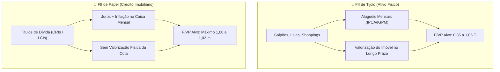

# Aula 5.2 — Fundamentos dos FIIs I: Tijolo vs Papel & Indicadores Chave

Nem todo Fundo Imobiliário é igual. Quando você abre o mercado da B3, existem centenas de códigos terminados em `11`, mas que operam com engrenagens econômicas completamente distintas.

Investidores despreparados costumam cometer um erro clássico: ordenam a lista pelo maior **Dividend Yield (DY)** e compram o fundo que mais pagou no último mês, caindo de cabeça em armadilhas de crédito podre ou ativos sem futuro.

Nesta aula, você aprenderá as diferenças anatômicas entre **FIIs de Tijolo** e **FIIs de Papel**, como dominar o indicador **P/VP** e como se proteger das ilusões do mercado.

---

## 🧱 1. FIIs de Tijolo vs FIIs de Papel

A divisão primária do universo imobiliário se dá pelo tipo de lastro que o fundo possui:

### 1. FIIs de Tijolo (Imóveis Físicos Reais)
- **O que são:** O fundo é o proprietário físico do terreno, do cimento e das paredes (galpões logísticos, lajes corporativas, shoppings centers, hospitais).
- **Como lucram:** Cobram aluguéis mensais dos lojistas e empresas locatárias. Esses contratos de aluguel são reajustados periodicamente pela inflação (IPCA ou IGPM).
- **Crescimento Patrimonial:** Ao longo de 10 ou 20 anos, os imóveis se valorizam no mercado imobiliário físico, elevando o valor intrínseco das suas cotas.

### 2. FIIs de Papel (Crédito e Recebíveis Imobiliários)
- **O que são:** O fundo não tem tijolos; ele atua como um "banco imobiliário", investindo em títulos de dívida emitidos por construtoras e incorporadoras (principalmente **CRIs — Certificados de Recebíveis Imobiliários**).
- **Como lucram:** Recebem amortizações de juros e correção monetária (ex: `IPCA + 7% ao ano` ou `CDI + 3% ao ano`).
- **Comportamento:** Distribuem proventos muito elevados e rápidos na conta, mas **não possuem valorização física do patrimônio**. A cota tende a oscilar ao redor de R$ 100,00 ou R$ 10,00 ao longo de toda a vida.

---

## 🔍 2. O Indicador P/VP: Você Está Pagando Ágio ou Desconto?

O múltiplo mais importante para avaliar o preço de um Fundo Imobiliário é o **P/VP (Preço de Mercado sobre o Valor Patrimonial)**:
$$\text{P/VP} = \frac{\text{Preço da Cota na Bolsa}}{\text{Valor Patrimonial da Cota (Laudo de Avaliação)}}$$

- **P/VP = 1,00:** O fundo está sendo negociado exatamente pelo valor contábil dos seus ativos.
- **P/VP < 1,00:** O fundo está sendo vendido com **desconto** na Bolsa (ex: P/VP de 0,90 significa que você está pagando 90 centavos por cada 1 real de patrimônio).
- **P/VP > 1,00:** O fundo está sendo vendido com **ágio** (mais caro do que o laudo).

### 🚨 A Regra de Ouro do P/VP por Categoria:
- **Nos FIIs de Tijolo:** É saudável comprar com P/VP entre **0,85 e 1,05**. Pagar até 5% de ágio em imóveis de excelência na Faria Lima é aceitável, mas evite pagar P/VP acima de 1,10.
- **Nos FIIs de Papel:** **NUNCA compre com P/VP acima de 1,02!** Como o patrimônio de um fundo de papel é composto por contratos de dívida em moeda corrente, pagar R$ 1,15 por um título que vale R$ 1,00 significa comprar dinheiro pagando mais caro do que ele vale. É prejuízo matemático na largada.

---

## ⚠️ 3. A Perigosa Armadilha do Dividend Yield (DY)

O **Dividend Yield** mede a relação entre os proventos pagos nos últimos 12 meses e o preço atual da cota:
- Se você vir um fundo com Dividend Yield de **18% ou 20% ao ano**, acenda todos os alertas vermelhos!
- Esse yield estratosférico quase sempre acontece por dois motivos perigosos:
  1. **Venda Pontual de um Imóvel:** O fundo vendeu um prédio e distribuiu o ganho de capital extraordinário no mês (não vai se repetir).
  2. **Risco Excessivo de Crédito (High Yield / Junk):** O fundo de papel investiu em títulos de devedores duvidosos que estão prestes a dar calote. Quando o calote estoura, a cota desaba 50% e os proventos cessam.

> 🛡️ **O Padrão Norte Invest:** Buscamos fundos **High Grade** (alta qualidade de crédito e imóveis impecáveis) com yields sustentáveis e equilibrados (entre 8% a 12% ao ano), com segurança e previsibilidade.

---

## 📱 4. Aplicação Prática no App Norte Invest

No **Norte Invest V2 Enterprise**, você tem clareza visual total:
1. Abra o **Radar de Ativos** (`/radar`) na aba **FIIs**.
2. Veja o indicador **P/VP** com destaque de cor: verde para desconto, cinza neutro para preço justo e amarelo/vermelho para ágio excessivo.
3. Filtre facilmente por categoria (Tijolo Logística, Lajes Corporativas, Shoppings e Papel High Grade).

---

## 📊 5. Infográfico: Tijolo vs Papel

---

## 🎙️ 6. Prompt para Áudio no Google NotebookLM

> **Como gerar o podcast desta aula:**
> 1. Copie o texto desta aula.
> 2. Cole como nova fonte em [notebooklm.google.com](https://notebooklm.google.com/).
> 3. No campo de personalização do *Audio Overview*, cole a instrução abaixo e clique em **Generate**:
> 
> *"Apresentem uma aula técnica e envolvente sobre a anatomia dos Fundos Imobiliários. Expliquem detalhadamente as diferenças entre FIIs de Tijolo e FIIs de Papel, ensinem a fórmula e o limite saudável do P/VP para cada um deles, e alertem os ouvintes com veemência contra a ilusão de comprar fundos apenas pelo maior Dividend Yield. Demonstrem como o Radar do Norte Invest sinaliza o P/VP ideal para compras seguras."*
