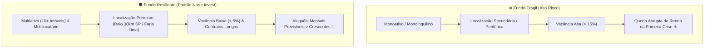

# Aula 5.3 — Fundamentos dos FIIs II: Qualidade Imobiliária e Contratos

No mercado imobiliário, existe um bordão mundial consagrado que atravessou séculos:
> *"Os três fatores que definem o valor de um imóvel são: **Localização, Localização e Localização**."*

Quando você investe em um FII de Tijolo, você está comprando a participação física em edifícios reais. Se esses imóveis estiverem situados em regiões decadentes, distantes das rotas comerciais ou com estruturas ultrapassadas, nenhum gestor brilhante conseguirá fazer milagres para alugá-los.

Nesta aula, você aprenderá os **quatro filtros de ouro da engenharia imobiliária** para auditar a qualidade dos ativos, entender a diferença entre contratos típicos e atípicos e nunca mais se preocupar com imóveis desocupados.

---

## 🏢 1. O Perigo Mortal do "Monoativo" e "Monoinquilino"

A primeira regra eliminatória na análise de qualquer fundo imobiliário é a sua estrutura de concentração:

- ❌ **Fundo Monoativo / Monoinquilino (Proibido):** O fundo possui apenas **um único imóvel**, alugado para **uma única empresa** (por exemplo, um prédio alugado exclusivamente para uma agência bancária ou um hospital específico). 
  - **O Risco:** Se o contrato vencer e o inquilino decidir mudar de endereço, **100% da renda do fundo desaparece de um dia para o outro**. A vacância pula para 100%, o aluguel mensal zera e você ainda terá que pagar o condomínio e o IPTU do imóvel vazio.
- ✅ **Fundo Multiativo e Multilocatário (Padrão Norte Invest):** O fundo possui **15, 20 ou 30 galpões logísticos ou shoppings**, espalhados por diferentes regiões e alugados para **mais de 50 empresas multinacionais e gigantes do varejo**.
  - **A Segurança:** Se uma empresa devolver 3 galpões, as outras 47 continuam pagando o aluguel normalmente. O impacto na sua renda mensal é imperceptível.

---

## 📍 2. Localização Primária: Onde Estão os Melhores Imóveis?

Não adianta ter um galpão logístico moderno no meio do deserto. A localização determina se o imóvel terá fila de empresas querendo alugá-lo ou se ficará anos às moscas:

- **Galpões Logísticos (Raio de 30 km a 60 km de São Paulo):** Com o crescimento brutal do comércio eletrônico e da entrega expressa (*same-day delivery*), as maiores empresas do mundo (Amazon, Mercado Livre, Shopee, Magalu) pagam valores elevados para estar a menos de 1 hora da maior região metropolitana consumidora da América Latina.
- **Lajes Corporativas (Eixos Nobres):** Em escritórios corporativos, o padrão de excelência se concentra em eixos consagrados de São Paulo e Rio de Janeiro (Avenida Brigadeiro Faria Lima, Itaim Bibi, Vila Olímpia e Avenida Paulista). Prédios nessas regiões possuem valor por metro quadrado resiliente mesmo em períodos de crise.

---

## 🚪 3. Vacância Física vs Vacância Financeira

Ao ler os relatórios gerenciais mensais disponibilizados pelos fundos, você encontrará dois indicadores de desocupação:

1. **Vacância Física:** É a porcentagem de metros quadrados vazios em relação à Área Bruta Locável (ABL) total do fundo.  
   *Exemplo: Um fundo com 100.000 m² de ABL que possui 5.000 m² desocupados tem uma Vacância Física saudável de apenas 5%.*
2. **Vacância Financeira:** É a porcentagem da renda potencial de aluguel que não está sendo arrecadada.  
   *Geralmente anda próxima da física, mas pode variar se o fundo conceder meses de carência para novos locatários.*

> 🛡️ **O Crivo Norte Invest:** Priorizamos fundos com **vacância física historicamente inferior a 8% a 10%**, demonstrando alta atratividade comercial dos imóveis.

---

## 📝 4. Contratos Típicos vs Contratos Atípicos (*Built to Suit*)

A natureza jurídica dos contratos de aluguel define a previsibilidade dos seus proventos nos próximos anos:

| Tipo de Contrato | Prazo Típico | Como Funciona a Rescisão? | Comportamento Econômico |
| :--- | :--- | :--- | :--- |
| **Contrato Típico** | 3 a 5 anos | Regido pela Lei do Inquilinato tradicional. O inquilino pode desocupar avisando com 30 dias e pagando multa proporcional leve. A cada 3 anos há **Revisional de Aluguel** para o preço de mercado. | Excelente em momentos de aquecimento econômico, pois permite subir o aluguel na revisional. |
| **Contrato Atípico** *(Built to Suit)* | **10 a 20 anos** | O imóvel é construído ou reformado sob medida para o locatário. **Se o inquilino quiser sair antes do prazo, a multa é de 100% de todos os aluguéis restantes até o último mês do contrato!** | **Máxima Previsibilidade de Renda.** Garante um fluxo constante de caixa protegido contra rescisões prematuras. |

---

## 📱 5. Aplicação Prática no App Norte Invest

No **Norte Invest V2 Enterprise**, você audita a carteira de imóveis sem ler relatórios de 50 páginas:
1. Abra o **Radar de Ativos** (`/radar`) na aba **FIIs**.
2. Veja o número de imóveis, estados de atuação, percentual de vacância e tipo predominante de contrato destacados no card.
3. Se um fundo for monoativo ou tiver vacância perigosa, o sistema exibe um aviso preventivo.

---

## 📊 6. Infográfico: A Matriz de Qualidade Imobiliária

---

## 🎙️ 7. Prompt para Áudio no Google NotebookLM

> **Como gerar o podcast desta aula:**
> 1. Copie o texto desta aula.
> 2. Cole como nova fonte em [notebooklm.google.com](https://notebooklm.google.com/).
> 3. No campo de personalização do *Audio Overview*, cole a instrução abaixo e clique em **Generate**:
> 
> *"Apresentem uma aula muito interessante e prática sobre como analisar os imóveis de um Fundo Imobiliário. Detalhem por que os fundos monoativos são uma verdadeira armadilha para o investidor, expliquem a importância estratégica da localização primária nos galpões logísticos e lajes corporativas, e contrastem os contratos típicos com a segurança absoluta dos contratos atípicos Built to Suit. Demonstrem como o Norte Invest resume esses dados para poupar tempo do investidor."*
