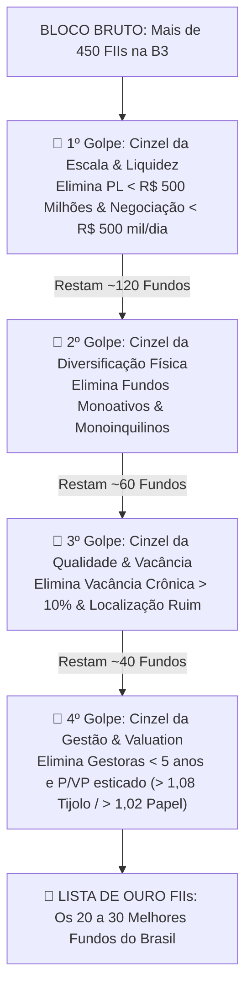
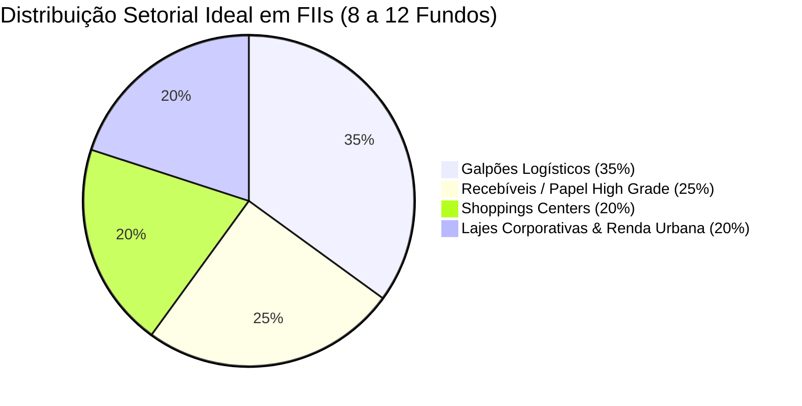

# Aula 5.5 — O Filtro MFS para FIIs: Carteira Blindada & Renda Perpétua

Chegamos à aula culminante do Módulo de Fundos Imobiliários. Nas aulas anteriores, você dominou a anatomia dos ativos (Tijolo vs Papel), a qualidade física dos imóveis (localização e contratos atípicos) e a idoneidade das gestoras.

Agora, vamos unificar todo esse conhecimento através do **cinzel do Filtro MFS aplicado aos FIIs** e aprender a estruturar uma carteira imobiliária diversificada, antifrágil e capaz de pingar aluguéis crescentes na sua conta corrente todos os meses pelo resto da sua vida.

---

## 🔨 1. O Cinzel DAVI Imobiliário: De 450 Fundos para a Lista de Ouro

Hoje existem mais de **450 Fundos Imobiliários listados na B3**. Mais de 70% deles são fundos pequenos, ilíquidos, monoativos ou com gestoras inexperientes.

Veja como o Filtro MFS elimina as imperfeições do bloco bruto:

---

## 🏛️ 2. A Estrutura da Carteira Imobiliária Perfeita (8 a 12 FIIs)

Para construir um império de renda passiva que não sofra abalos, o MANTFRAI recomenda selecionar entre **8 a 12 Fundos Imobiliários** da Lista de Ouro, distribuídos estrategicamente em quatro grandes pilares:

| Pilar Imobiliário | Peso Sugerido | Função Estratégica na Carteira | Exemplos Típicos de Excelência |
| :--- | :---: | :--- | :--- |
| **Galpões Logísticos** | **35%** | **Crescimento & Previsibilidade:** Contratos atípicos de 10 anos alugados para gigantes do comércio eletrônico no raio de 30 km de SP. | `HGLG11`, `BTLG11`, `XPLG11`. |
| **Recebíveis (Papel High Grade)** | **25%** | **Geração Imediata de Caixa:** Títulos de dívida de devedores triplo A, entregando IPCA + 6% ou CDI + 2% limpos todo mês. | `KNIP11`, `KNCR11`, `KNSC11`. |
| **Shoppings Centers** | **20%** | **Proteção contra Inflação:** Participação no faturamento de milhares de lojas em shoppings consolidados nas capitais brasileiras. | `XPML11`, `VISC11`, `HGBS11`. |
| **Lajes Corporativas / Renda Urbana** | **20%** | **Valorização Patrimonial:** Edifícios comerciais triplo A na Faria Lima e imóveis de varejo alimentar essencial. | `KNRI11`, `HGRE11`, `TRXF11`. |

> 🔒 **Teto por FII Individual:** Nenhum fundo imobiliário deve ultrapassar **10% a 12%** do total alocado em FIIs. Se um galpão sofrer um sinistro ou um inquilino atrasar o aluguel, sua renda global continua intacta.

---

## 📱 3. Aplicação Prática no App MANTFRAI

No **MANTFRAI Enterprise**, todo esse ecossistema trabalha de forma integrada:
1. Acesse o **Radar de Ativos** (`/radar`) para selecionar os FIIs da Lista de Ouro e incluí-los na sua carteira.
2. Defina os percentuais de cada um no menu **Definir Objetivos** (`/definir-objetivos`).
3. No dia do seu aporte mensal, abra a tela **Onde Aportar** (`/onde-aportar`): o algoritmo **Motor RDM** verifica automaticamente qual fundo de tijolo ou papel está com o melhor preço e menor P/VP no momento e indica o aporte exato com desconto!
4. Acompanhe a bola de neve crescendo na tela **Renda Passiva** (`/renda-passiva`).

---

## ⚠️ 4. O Erro Fatal do Amador

> 🚫 **O Erro:** Vender as cotas de um FII excelente de tijolo só porque a cotação caiu 5% no mês devido ao anúncio de uma alta temporária na taxa Selic.
> 
> 🛡️ **A Postura MANTFRAI:** Os prédios continuam no mesmo lugar e os contratos continuam sendo pagos. Queda de cotação em bons FIIs é apenas um convite para o algoritmo Motor RDM comprar mais cotas com desconto e aumentar a sua taxa de retorno em proventos (*Yield on Cost*).

---

## 📊 5. Infográfico: A Distribuição Antifrágil em FIIs

---

## 🎙️ 6. Prompt para Áudio no Google NotebookLM

> **Como gerar o podcast desta aula:**
> 1. Copie o texto desta aula.
> 2. Cole como nova fonte em [notebooklm.google.com](https://notebooklm.google.com/).
> 3. No campo de personalização do *Audio Overview*, cole a instrução abaixo e clique em **Generate**:
> 
> *"Apresentem uma aula final empolgante e muito prática sobre como montar uma carteira completa de Fundos Imobiliários com o Filtro MFS. Usem o funil de eliminação para mostrar como 450 fundos se transformam em uma Lista de Ouro de elite, detalhem a divisão setorial recomendada (logística, papel, shoppings e lajes corporativas) e mostrem como o algoritmo Motor RDM do MANTFRAI garante compras mecânicas com desconto e renda passiva crescente para toda a vida."*
