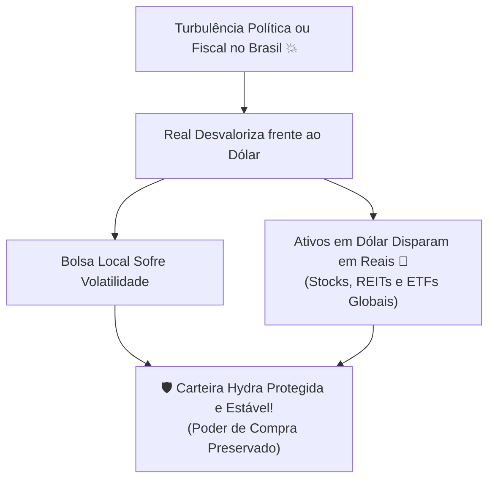

# Aula 6.1 — Por que Investir no Exterior: Risco-Brasil & Poder de Compra Global

Se você mora no Brasil, trabalha no Brasil, recebe seu salário em Reais e investe 100% do seu dinheiro exclusivamente na Bolsa de Valores brasileira, você está correndo um risco patrimonial invisível e gigantesco: **o Risco Soberano do País**.

Você sabia que todo o mercado de capitais brasileiro (todas as ações da B3 somadas) representa **menos de 2% do mercado financeiro mundial**? 

Ao deixar todo o seu patrimônio restrito às fronteiras nacionais, você está voluntariamente ignorando 98% das maiores e mais inovadoras empresas do planeta e mantendo sua vida refém de uma moeda emergente e historicamente inflacionária.

Nesta aula, você entenderá por que dolarizar parte do seu patrimônio não é um luxo para bilionários, mas uma necessidade elementar de sobrevivência e blindagem familiar.

---

## 📉 1. A Erosão Silenciosa do Real

Desde o lançamento do Plano Real em 1994, quando R$ 1,00 equivalia a US$ 1,00, a moeda brasileira perdeu mais de **85% do seu poder de compra**:
- O Dólar saltou de R$ 1,00 para patamares superiores a R$ 5,00 e R$ 6,00.
- E não se engane achando que o preço do dólar só afeta quem viaja para Miami ou compra perfumes importados:
  - O pãozinho da padaria é feito de **trigo cotado em dólar**.
  - O combustível do seu carro segue a **paridade internacional do barril de petróleo**.
  - O seu celular, o seu computador, os medicamentos da sua farmácia e os fertilizantes da nossa agricultura são todos **precificados na moeda americana**.

Quando o Real se desvaloriza, o seu custo de vida no supermercado sobe imediatamente. Se você não tiver ativos que rendam e se valorizem em moeda forte, o seu poder de compra global será impiedosamente triturado pela inflação.

---

## 🌍 2. Acesso aos Maiores Monopólios da Humanidade

Ao investir no exterior, você deixa de ser sócio apenas de empresas que dependem do consumidor brasileiro e passa a ser coproprietário das marcas mais dominantes da história moderna:
- **Apple, Microsoft, Google (Alphabet), Amazon e Nvidia:** Corporações com caixas bilionários superiores ao PIB de dezenas de países somados.
- **Johnson & Johnson, Coca-Cola, Procter & Gamble:** Gigantes de consumo cujos produtos são utilizados por bilhões de pessoas todos os dias nos cinco continentes.
- **REITs Globais:** Fundos imobiliários internacionais donos de torres de telefonia 5G, data centers de inteligência artificial e hospitais de ponta nos Estados Unidos e Europa.

---

## 🐉 3. O Quarto Tentáculo da Carteira Hydra

Lembre-se da lição do Módulo 2 sobre a descorrelação de forças:
- Quando o Brasil passa por uma crise política ou incerteza fiscal e a Bolsa brasileira cai, **o Dólar quase sempre dispara em relação ao Real**.
- Na sua Carteira Hydra, o seu patrimônio internacional em Dólar valoriza instantaneamente em Reais, amortecendo qualquer queda e mantendo seu patrimônio total equilibrado e sereno.

---

## 📱 4. Aplicação Prática no App Norte Invest

No **Norte Invest V2 Enterprise**, você acompanha sua exposição internacional em tempo real:
1. Acesse **Definir Objetivos** (`/definir-objetivos`) e configure a fatia da sua carteira destinada a **Ativos Internacionais** (recomendado entre 10% e 25%).
2. No menu **Carteira** (`/carteira`), visualize sua alocação dividida entre ativos locais e dolarizados.
3. O algoritmo **AM2O** monitora as oscilações cambiais e sinaliza o momento exato de aportar lá fora quando a cotação internacional estiver mais favorável.

---

## ⚠️ 5. O Erro Fatal do Amador

> 🚫 **O Erro:** Ficar tentando adivinhar se o Dólar vai cair para R$ 4,80 ou subir para R$ 6,20 para "fazer câmbio na hora certa".
> 
> 🛡️ **A Postura Norte Invest:** Câmbio não se adivinha; câmbio se **faz com disciplina mensal**. O objetivo não é acertar a cotação da semana, mas acumular patrimônio na moeda mais líquida, confiável e aceita do planeta Terra.

---

## 📊 6. Infográfico: A Blindagem do Capital Global

---

## 🎙️ 7. Prompt para Áudio no Google NotebookLM

> **Como gerar o podcast desta aula:**
> 1. Copie o texto desta aula.
> 2. Cole como nova fonte em [notebooklm.google.com](https://notebooklm.google.com/).
> 3. No campo de personalização do *Audio Overview*, cole a instrução abaixo e clique em **Generate**:
> 
> *"Produzam uma aula reveladora e provocativa sobre a necessidade urgente de internacionalizar o patrimônio. Expliquem como o Brasil representa menos de 2% do mercado global e mostrem a perda histórica de 85% do poder de compra do Real desde 1994. Demonstrem como o pãozinho da padaria e o celular dependem do dólar e expliquem por que a parcela internacional da Carteira Hydra do Norte Invest salva o investidor das crises locais."*
