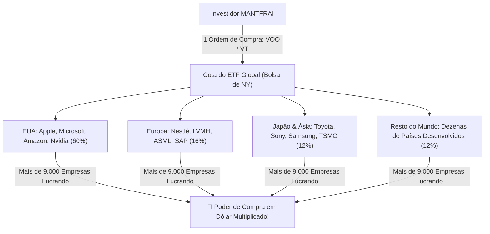

# Aula 6.2 — Os Melhores Veículos no Exterior: A Elegância dos ETFs

Agora que você já entendeu por que precisa proteger seu patrimônio em moeda forte, surge a grande dúvida operacional:
> *"Como escolher os melhores ativos nos Estados Unidos? Devo passar horas analisando balanços em inglês de dezenas de empresas americanas, ou existe uma rota mais simples, barata e eficiente?"*

A resposta é uma das maiores inovações financeiras do último século: **os ETFs (Exchange Traded Funds) de Gestão Passiva**.

Nesta aula, você aprenderá como uma única ordem de compra na Bolsa de Nova York pode transformar você em sócio instantâneo de mais de 500 ou até 9.000 das maiores corporações do planeta Terra, pagando uma taxa de administração praticamente invisível.

---

## 🚀 1. O que é um ETF e por que ele é Revolucionário?

Um ETF é um fundo de investimento negociado em Bolsa exatamente como se fosse uma ação comum:
- Em vez de tentar "adivinhar" qual ação vai subir mais, o ETF replica de forma neutra e automatizada um índice consagrado de mercado.
- **Custo Praticamente Zero:** Enquanto os fundos brasileiros tradicionais cobram 2% ao ano de taxa de administração, os grandes ETFs mundiais cobram taxas ridículas de **0,03% ao ano**. Isso significa pagar apenas **US$ 3,00 por ano** para cada US$ 10.000 investidos!
- **Auditoria e Rebalanceamento Automático:** O próprio índice se encarrega de descartar empresas que perderam relevância e incluir automaticamente as novas gigantes que estão crescendo.

---

## 🏆 2. Os Principais Campeões Globais

Ao internacionalizar seu capital, estes são os três principais instrumentos utilizados pelos investidores de classe mundial:

| Código (Ticker) | Nome do ETF | O que tem Dentro? | Taxa Anual | Função Estratégica |
| :--- | :--- | :--- | :---: | :--- |
| **VOO** / **IVV** | Vanguard S&P 500 / iShares Core S&P 500 | As **500 maiores empresas dos Estados Unidos** (Apple, Microsoft, Nvidia, Google, Amazon, Berkshire, Tesla, etc.). | **0,03% a.a.** | O motor de crescimento e rentabilidade mais vitorioso da história do capitalismo. |
| **VT** | Vanguard Total World Stock | Mais de **9.000 empresas em mais de 40 países** (EUA, Europa, Japão, Reino Unido, Ásia e mercados emergentes). | **0,07% a.a.** | A diversificação geográfica definitiva. Você se torna dono de praticamente toda a economia do planeta em uma só cota. |
| **VNQ** | Vanguard Real Estate ETF | Mais de **160 REITs** (os Fundos Imobiliários americanos), donos de data centers, torres de celular, galpões e shoppings globais. | **0,12% a.a.** | Exposição à renda imobiliária mais sólida e líquida do mundo. |

---

## 🏢 3. ETFs vs Stocks & REITs Individuais

Você também tem a liberdade de comprar ações de empresas individuais americanas (**Stocks**) ou fundos imobiliários individuais (**REITs**):
- **A Abordagem com ETFs (Recomendada para 90% dos Investidores):** Máxima simplicidade. Com apenas 1 ou 2 ativos (`VOO` ou `VT`), você resolve 100% da sua parcela internacional em menos de 2 minutos por mês.
- **A Abordagem com Stocks e REITs Diretos:** Para quem deseja montar uma carteira seleta de companhias históricas com lucros e dividendos crescentes há mais de 25 anos consecutivos (as célebres *Dividend Aristocrats*, como Coca-Cola, Johnson & Johnson, Procter & Gamble e Realty Income).

---

## 📱 4. Aplicação Prática no App MANTFRAI

No **MANTFRAI Enterprise**, você cadastra e monitora seus investimentos globais:
1. No **Radar de Ativos** (`/radar`), selecione a aba **Exterior** para visualizar ETFs, Stocks e REITs aprovados pelo Filtro MFS.
2. Defina os ativos internacionais na sua **Carteira** (`/carteira`).
3. O algoritmo **Motor RDM** converte os valores em Reais e Dólares e calcula o momento ideal de aportar no tentáculo internacional sem sofrer com ansiedade cambial.

---

## ⚠️ 5. O Erro Fatal do Amador

> 🚫 **O Erro:** Comprar ETFs setoriais da moda ou de temas hiperespecíficos (ex: ETF de maconha, ETF de metaverso, ETF alavancado 3x).
> 
> 🛡️ **A Postura MANTFRAI:** Fugimos de modismos passageiros. Nós investimos na economia real global através de índices amplos, consagrados e neutros ponderados por valor de mercado.

---

## 📊 6. Infográfico: A Amplitude de um ETF Global

---

## 🎙️ 7. Prompt para Áudio no Google NotebookLM

> **Como gerar o podcast desta aula:**
> 1. Copie o texto desta aula.
> 2. Cole como nova fonte em [notebooklm.google.com](https://notebooklm.google.com/).
> 3. No campo de personalização do *Audio Overview*, cole a instrução abaixo e clique em **Generate**:
> 
> *"Produzam uma aula dinâmica e fascinante sobre a simplicidade e a eficiência dos ETFs globais. Expliquem como uma cota de ETFs como o VOO ou o VT permite a qualquer cidadão comum ser dono das maiores multinacionais do mundo pagando taxas quase nulas de 0,03% ao ano. Comparem a facilidade dos ETFs com a análise de ações individuais e demonstrem como o MANTFRAI integra o investimento no exterior de forma descomplicada."*
