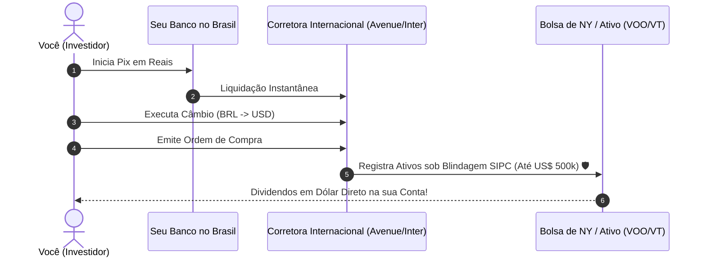

# Aula 6.3 — Operando no Exterior na Prática: Corretoras & Câmbio

Antigamente, investir nos Estados Unidos exigia falar inglês fluente, possuir passaporte internacional, assinar contratos físicos e enviar ordens de remessa por telefone com taxas de transferência internacional que custavam centenas de dólares.

Hoje, essa realidade mudou radicalmente. Qualquer brasileiro pode abrir uma conta de investimentos regulamentada nos Estados Unidos em menos de 5 minutos, utilizando apenas o telefone celular, e enviar recursos por Pix com liquidação instantânea.

Nesta aula, você aprenderá o passo a passo seguro para internacionalizar seu dinheiro, entenderá como funciona a **blindagem de até US$ 500.000 do SIPC** e dominará as regras fiscais sem complicações.

---

## 📱 1. A Escolha da Corretora Internacional

Hoje existem corretoras americanas de primeira linha desenhadas sob medida para o investidor brasileiro, com atendimento 100% em português e relatórios fiscais automatizados:

- **Avenue Securities:** Uma das pioneiras e mais utilizadas por brasileiros, com custódia regulada pela SEC e FINRA e relatórios prontos para o Imposto de Renda brasileiro.
- **Inter Global / Nomad:** Plataformas integradas a bancos digitais brasileiros que oferecem conta corrente e de investimentos em dólar no mesmo aplicativo.
- **Interactive Brokers & Charles Schwab:** Gigantes globais de corretagem, recomendadas para investidores com posições multibilionárias ou que queiram operar diretamente em dezenas de bolsas pelo mundo.

> 🔒 **Critério Inegociável:** A instituição deve ser membro registrado da **SEC (Securities and Exchange Commission)** e da **FINRA (Financial Industry Regulatory Authority)** dos Estados Unidos.

---

## 🏛️ 2. A Blindagem do SIPC: Proteção de até US$ 500.000

Nos Estados Unidos, os investidores contam com uma das mais sólidas redes de segurança financeira do planeta: a **SIPC (Securities Investor Protection Corporation)**.

- Se a corretora internacional vier a falir ou passar por problemas societários, a SIPC protege as suas ações, ETFs e títulos em até **US$ 500.000 por cliente** (sendo até US$ 250.000 em dinheiro disponível).
- Na conversão atual de câmbio, isso representa uma garantia governamental de **mais de R$ 2,5 milhões a R$ 3 milhões de reais blindados por investidor**!

---

## 💸 3. O Fluxo de Câmbio: Do Pix ao Ativo em Nova York

O processo para comprar suas cotas é rápido e totalmente automatizado:

1. **Pix da sua Conta Brasileira:** Você faz uma transferência Pix em Reais para a sua corretora internacional.
2. **Câmbio Instantâneo:** Dentro do aplicativo da corretora, você clica em "Fazer Câmbio". O sistema converte os Reais para Dólares na hora, aplicando o IOF legal de 1,1% e a taxa de spread cambial da instituição.
3. **Ordem de Compra:** Com os Dólares na conta de investimento, basta buscar o código do ETF (ex: `VOO` ou `VT`) e enviar a ordem de compra.
4. Pronto! Em segundos você é dono de frações das maiores empresas americanas.

---

## ⚖️ 4. Como Funciona a Tributação no Exterior?

Com a modernização das regras tributárias brasileiras (Lei 14.754/2023), o investimento no exterior ganhou clareza e previsibilidade:

- **Tributação Anual de 15%:** Os rendimentos e ganhos de capital auferidos no exterior são declarados de forma unificada uma única vez ao ano, diretamente na Declaração de Ajuste Anual (DAA) do Imposto de Renda.
- **Dividendos Recebidos nos EUA:** O governo americano (IRS) retém na fonte 30% sobre os dividendos distribuídos por ações americanas. Graças ao princípio de reciprocidade tributária entre Brasil e EUA, esses valores já retidos são abatidos da sua apuração fiscal no Brasil, evitando dupla tributação.

---

## 📱 5. Aplicação Prática no App MANTFRAI

No **MANTFRAI Enterprise**, você unifica suas contas sem dor de cabeça:
1. Ao registrar transações no **Histórico** (`/historico`), basta selecionar a moeda (Dólar) ou o ativo internacional.
2. O sistema armazena a cotação de aquisição e mantém a posição consolidada convertida em Reais na sua **Carteira** (`/carteira`).
3. O algoritmo **Motor RDM** cuida para que você aporte lá fora de forma constante e sem estresse emocional.

---

## ⚠️ 6. O Erro Fatal do Amador

> 🚫 **O Erro:** Ficar com medo de enviar dinheiro para os Estados Unidos por achar que é "ilegal" ou "coisa de quem quer esconder dinheiro".
> 
> 🛡️ **A Postura MANTFRAI:** Investir no exterior é 100% legal, regulamentado pelo Banco Central do Brasil e pela Receita Federal. O mundo inteiro investe em Dólar; deixar todo o seu patrimônio amarrado a uma única moeda emergente é que é a verdadeira temeridade.

---

## 📊 7. Infográfico: O Circuito do Investimento Internacional

---

## 🎙️ 8. Prompt para Áudio no Google NotebookLM

> **Como gerar o podcast desta aula:**
> 1. Copie o texto desta aula.
> 2. Cole como nova fonte em [notebooklm.google.com](https://notebooklm.google.com/).
> 3. No campo de personalização do *Audio Overview*, cole a instrução abaixo e clique em **Generate**:
> 
> *"Apresentem uma aula descontraída, prática e animadora sobre como investir nos Estados Unidos na vida real. Expliquem como é fácil abrir uma conta internacional em português, detalhem a enorme segurança da blindagem de até 500 mil dólares pelo SIPC, passem o passo a passo do envio de Pix com câmbio instantâneo e desmistifiquem a tributação da Receita Federal. Mostrem como o MANTFRAI ajuda o investidor comum a dormir tranquilo com patrimônio em dólar."*
