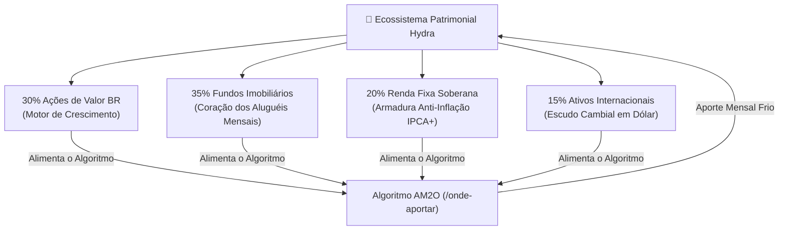

# Aula 7.1 — A Arquitetura da Carteira Hydra: O Ecossistema Integrado

Ao longo dos módulos anteriores, você adquiriu um arsenal completo de competências:
- Aprendeu a construir sua trincheira de **Reserva de Emergência** e escolher corretoras seguras.
- Dominou o cinzel do **Método DAVI** para selecionar as 30 melhores **Ações** da Bolsa brasileira.
- Aprendeu a escolher os **Fundos Imobiliários** mais resilientes com contratos atípicos e aluguéis isentos de impostos.
- Descobriu como dolarizar parte do capital com a elegância e simplicidade dos **ETFs Globais**.

Porém, ter um punhado de bons ativos espalhados não significa possuir uma carteira de investimentos.

Se você não tiver um plano de alocação estratégica coordenado, seu patrimônio continuará vulnerável ao sabor do improviso. Nesta aula, você aprenderá a unificar todos esses componentes sob a arquitetura antifrágil do **Mecanismo Hydra**.

---

## 🏛️ 1. O que é uma Carteira de Investimentos de Verdade?

Uma carteira de investimentos não é uma gaveta de colecionador onde você vai jogando códigos de ativos que viu na internet. 

> 💎 **Definição Norte Invest:** Uma carteira é um **sistema vivo de engenharia patrimonial**, onde cada classe de ativo cumpre uma função tática indispensável para manter o todo em equilíbrio e crescimento perpétuo.

Pense no corpo humano:
- O coração não compete com o pulmão; eles trabalham juntos. Se o pulmão falhar, o coração para.
- Na sua Carteira Hydra acontece a mesma coisa:
  - As **Ações de Valor** são o pulmão que oxigena o crescimento patrimonial no longo prazo.
  - Os **FIIs** são o coração que bombeia fluxo de proventos e liquidez mensal para a sua conta.
  - A **Renda Fixa Soberana** é a armadura que protege os órgãos vitais contra o veneno da inflação.
  - Os **Ativos Globais em Dólar** são o escudo contra a fragilidade da moeda local.

---

## ⚖️ 2. Personalizando os Pesos sem Mudar a Qualidade

No mercado tradicional, os bancos inventam questionários de "perfil de investidor" para empurrar produtos ruins com a desculpa de que o cliente é "conservador".

No **Norte Invest**, a regra é transparente: **os ativos de excelência da Lista de Ouro são os mesmos para qualquer investidor**. O que muda conforme o momento de vida e tolerância ao risco são apenas as proporções percentuais de cada tentáculo:

| Perfil Estratégico | Ações de Valor BR | Fundos Imobiliários (FIIs) | Renda Fixa Soberana | Ativos no Exterior (Dólar) |
| :--- | :---: | :---: | :---: | :---: |
| **Defensivo / Proventos** | 20% | **40%** | **30%** | 10% |
| **Equilibrado (Padrão Ouro)** | **30%** | **35%** | **20%** | **15%** |
| **Multiplicador / Acumulação** | **40%** | 30% | 10% | **20%** |

Observe que em qualquer uma das três configurações, **a sua carteira continua sendo uma Hydra completa e antifrágil**.

---

## 📱 3. Aplicação Prática no App Norte Invest

No **Norte Invest V2 Enterprise**, você materializa a sua estratégia em segundos:
1. Abra o menu **Definir Objetivos** (`/definir-objetivos`).
2. Defina os percentuais ideais para cada macroclasse (Ações, FIIs, Renda Fixa, Exterior), garantindo que a soma resulte em 100%.
3. Defina os percentuais de cada ativo individual dentro da sua classe correspondente.
4. O sistema grava os pesos e alimenta automaticamente o motor de cálculo do algoritmo **AM2O**.

---

## ⚠️ 4. O Erro Fatal do Amador

> 🚫 **O Erro:** Mudar as metas de porcentagem da carteira toda semana porque uma ação subiu muito ou porque saiu uma notícia assustadora no portal de notícias.
> 
> 🛡️ **A Postura Norte Invest:** As metas de alocação estratégica da sua Hydra são a Constituição do seu patrimônio. Elas são definidas com a mente fria e devem ser mantidas ao longo dos anos para permitir que a matemática do rebalanceamento funcione.

---

## 📊 5. Infográfico: A Orquestração da Carteira Hydra

---

## 🎙️ 6. Prompt para Áudio no Google NotebookLM

> **Como gerar o podcast desta aula:**
> 1. Copie o texto desta aula.
> 2. Cole como nova fonte em [notebooklm.google.com](https://notebooklm.google.com/).
> 3. No campo de personalização do *Audio Overview*, cole a instrução abaixo e clique em **Generate**:
> 
> *"Apresentem uma aula esclarecedora e motivadora sobre o conceito de ecossistema integrado na Carteira Hydra do Norte Invest. Usem a analogia dos órgãos do corpo humano para mostrar por que ações, fundos imobiliários, renda fixa soberana e investimentos no exterior precisam coexistir em harmonia. Demonstrem as três composições de pesos sugeridas e expliquem como a tela de Definir Objetivos do app programa as metas da sua mente financeira."*
