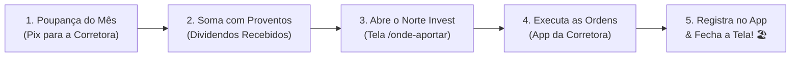

# Aula 7.3 — A Rotina Mensal do Investidor: O Ritual dos 15 Minutos

O cinema e as redes sociais venderam uma imagem distorcida e estressante do que significa investir: um operador hiperativo, com três monitores ligados, cercado de gráficos de barras coloridas, atendendo ligações aos gritos e tomando café sem parar.

Se essa é a imagem que você tinha de um investidor, prepare-se para uma surpresa libertadora.

Na metodologia **Norte Invest**, investir com maestria é um dos atos mais calmos, previsíveis e silenciosos da sua rotina. Você não precisa passar horas analisando notícias de política e não precisa acompanhar cotações no almoço.

Nesta aula, você aprenderá o **Ritual Mensal dos 15 Minutos** — o processo cirúrgico que constrói a sua independência financeira sem roubar o tempo do seu trabalho ou da sua família.

---

## ⏳ 1. O Paradoxo do Esforço nos Investimentos

Na maioria das áreas da vida humana, existe uma relação direta entre o tempo dedicado e os resultados obtidos:
- Se você estudar 4 horas por dia em vez de 30 minutos, passará melhor em um concurso.
- Se você treinar com consistência na academia, ganhará mais massa muscular.
- Se você trabalhar com mais dedicação no seu negócio, fechará mais contratos.

Porém, **no mercado financeiro acontece o oposto**:
> 📉 **O Paradoxo dos Mercados:** Quanto mais tempo você passa olhando para gráficos na tela, mais ansioso você fica, mais giros desnecessários você realiza, mais impostos você paga e **menor é a sua rentabilidade final**.

A sua renda ativa vem do seu trabalho, da sua profissão e da sua dedicação diária. O mercado financeiro é o lugar onde você coloca o fruto dessa renda para trabalhar por você — e não o lugar onde você cria um segundo emprego estressante.

---

## 📋 2. O Ritual dos Cinco Passos (15 Minutos uma Vez por Mês)

Para aplicar o Método DAVI & Hydra na sua vida, reserve apenas 15 minutos em um dia fixo todo mês (logo após receber o seu salário ou pró-labore):

### O Passo a Passo Detalhado:
1. **Passo 1 (Minuto 1 ao 3):** Transfira o valor que você se comprometeu a poupar no mês para a conta da sua corretora de valores.
2. **Passo 2 (Minuto 4 ao 5):** Veja quanto você acumulou de dividendos e proventos de FIIs recebidos ao longo do último mês que já estão disponíveis na corretora. Some esses proventos ao valor do seu aporte novo.
3. **Passo 3 (Minuto 6 ao 8):** Abra o **Norte Invest V2 Enterprise** no menu **Onde Aportar** (`/onde-aportar`) e digite o valor total disponível.
4. **Passo 4 (Minuto 9 ao 13):** O algoritmo AM2O exibe na tela exatamente quais ativos comprar (ex: 20 cotas de `HGLG11` e 30 ações de `ITUB4`). Abra o app da corretora e emita as ordens limitadas de compra.
5. **Passo 5 (Minuto 14 ao 15):** No Norte Invest, clique em `+ Nova Transação` no `/historico` para atualizar sua posição patrimonial.
6. **Pronto!** Desligue o computador, feche o aplicativo da corretora e vá viver a sua vida. Seu patrimônio trabalhou e se rebalanceou com perfeição cirúrgica.

---

## 📱 3. Onde Focar o Restante do Mês?

Nos outros 29 dias e 23 horas e 45 minutos do mês, onde deve estar o seu foco?
- **Na sua profissão:** Desenvolva novas habilidades, encante seus clientes, conquiste promoções ou aumente o faturamento da sua empresa para que a sua **capacidade de aporte mensal cresça**.
- **Na sua família e saúde:** Pratique esportes, passe tempo com quem você ama e desfrute da paz de espírito de saber que o seu futuro financeiro está sendo esculpido por um método matemático infalível.

---

## ⚠️ 4. O Erro Fatal do Amador

> 🚫 **O Erro:** Ficar abrindo o aplicativo da corretora dez vezes por dia para ver se a cotação subiu ou caiu R$ 0,10.
> 
> 🛡️ **A Postura Norte Invest:** Quem fica olhando cotação todo dia é especulador ansioso. O investidor inteligente olha seus investimentos uma vez por mês para aportar e uma vez a cada três meses para checar se os balanços trimestrais continuam dando lucros sólidos.

---

## 🎙️ 5. Prompt para Áudio no Google NotebookLM

> **Como gerar o podcast desta aula:**
> 1. Copie o texto desta aula.
> 2. Cole como nova fonte em [notebooklm.google.com](https://notebooklm.google.com/).
> 3. No campo de personalização do *Audio Overview*, cole a instrução abaixo e clique em **Generate**:
> 
> *"Apresentem uma aula muito descontraída, reconfortante e prática sobre a simplicidade de investir com o Norte Invest. Desconstruam o mito de Wall Street de que é preciso ficar vidrado na tela o dia inteiro, expliquem o 'Paradoxo do Esforço' no mercado financeiro e apresentem o Ritual dos 15 Minutos Mensais passo a passo. Enfatizem como o app Norte Invest liberta o tempo do usuário para ele focar no trabalho e na família enquanto o dinheiro trabalha sozinho."*
