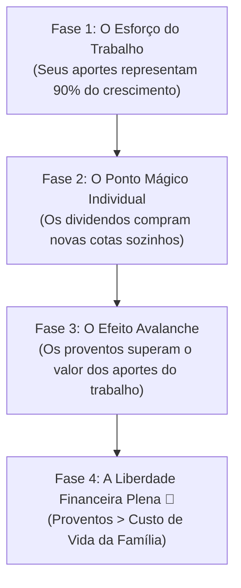

# Aula 7.4 — O Efeito Bola de Neve & A Conquista do Ponto Mágico

Existe um instante mágico na vida de todo investidor paciente. É o dia em que você abre o extrato da sua conta e percebe que o dinheiro gerado pelos seus investimentos começou a trabalhar com mais força e intensidade do que o próprio suor do seu trabalho.

Esse fenômeno não é fruto da sorte ou da especulação; é a consequência matemática inevitável da fórmula dos juros compostos aplicada com disciplina através do Filtro MFS.

Nesta aula de coroação do Módulo 7, você aprenderá o conceito do **Ponto Mágico (Magic Number)**, como calcular o momento exato em que seus ativos se tornam autossuficientes e como acompanhar essa engrenagem no painel do MANTFRAI.

---

## 🎯 1. O que é o "Ponto Mágico" (*Magic Number*)?

No ecossistema de investimentos em Fundos Imobiliários e Ações de dividendos, o Ponto Mágico representa a transição entre o esforço manual e a multiplicação automática:

> 👑 **Definição do Ponto Mágico Individual:** É o número exato de cotas que você precisa acumular de um ativo para que **os proventos mensais pagos por ele sejam suficientes para comprar uma nova cota inteira daquele mesmo papel sem você colocar um único centavo a mais do bolso!**

### A Fórmula do Ponto Mágico:
$$\text{Número de Cotas do Ponto Mágico} = \frac{\text{Preço de Mercado da Cota}}{\text{Rendimento Médio Mensal por Cota}}$$

### O Exemplo Prático:
- Imagine um Fundo Imobiliário com cota a **R$ 100,00** que distribui um aluguel médio de **R$ 1,00 por cota todo mês**.
- Aplicando a fórmula:
  $$\frac{100}{1} = \mathbf{100 \text{ cotas}}$$
- **O que acontece quando você atinge 100 cotas?**
  - No próximo mês, suas 100 cotas depositam **R$ 100,00 líquidos** na sua conta.
  - Você usa esses R$ 100,00 e compra a cota de número **101**.
  - No mês seguinte, você tem 101 cotas trabalhando, gerando R$ 101,00, permitindo comprar mais uma cota e ainda sobrar troco!
  - O ativo se tornou uma **máquina reprodutiva autônoma**: ele passa a se multiplicar sozinho todos os meses, quer você aporte dinheiro novo ou não.

---

## 🏆 2. O Grande Ponto Mágico Patrimonial: A Liberdade Absoluta

Se o Ponto Mágico individual é o combustível dos seus ativos, o **Grande Ponto Mágico Patrimonial** é o destino final de toda a sua jornada financeira:

> 🌟 **A Independência Financeira:** Ocorre no dia em que **a renda média mensal de proventos da sua Carteira Antifrágil ultrapassa o seu Custo de Vida Básico Mensal**.

A partir desse momento crucial:
- Trabalhar deixa de ser uma obrigação de sobrevivência para se tornar uma escolha de realização pessoal.
- Você ganha a maior riqueza que o dinheiro pode comprar: **o domínio soberano sobre o seu próprio tempo**.
- As despesas da sua família estão garantidas pelo lucro de dezenas de grandes empresas e centenas de imóveis comerciais de primeira linha que trabalham para você ininterruptamente.

---

## 📱 3. Aplicação Prática no App MANTFRAI

No **MANTFRAI Enterprise**, você acompanha a contagem regressiva para a sua liberdade:
1. Acesse o menu **Renda Passiva** (`/renda-passiva`).
2. Observe o velocímetro de **Cobertura do Custo de Vida**: ele mostra graficamente a porcentagem exata das suas despesas mensais que já estão sendo pagas exclusivamente pelos seus dividendos (ex: `42% das contas pagas pelos ativos`).
3. No gráfico de barras anual, veja a clássica "escadinha dos dividendos" subindo ano após ano, comprovando a força exponencial da sua Carteira Antifrágil.

---

## ⚠️ 4. O Erro Fatal do Amador

> 🚫 **O Erro:** Desanimar nos primeiros meses porque os proventos são de alguns reais (ex: "só recebi R$ 15,00 este mês").
> 
> 🛡️ **A Postura MANTFRAI:** Todo carvalho gigante um dia foi uma pequena semente na terra. Aquele que despreza os R$ 15,00 de hoje nunca terá a disciplina para administrar os R$ 15.000,00 de amanhã. Celebre cada dividendo recebido, reinvesta cada centavo pelo Motor RDM e veja a matemática transformar a semente em um império inabalável.

---

## 📊 5. Infográfico: A Curva Exponencial do Ponto Mágico

---

## 🎙️ 6. Prompt para Áudio no Google NotebookLM

> **Como gerar o podcast desta aula:**
> 1. Copie o texto desta aula.
> 2. Cole como nova fonte em [notebooklm.google.com](https://notebooklm.google.com/).
> 3. No campo de personalização do *Audio Overview*, cole a instrução abaixo e clique em **Generate**:
> 
> *"Apresentem uma aula triunfante, inspiradora e cientificamente embasada sobre a chegada ao Ponto Mágico no MANTFRAI. Expliquem detalhadamente a fórmula do Magic Number em FIIs e ações, a emoção de ver a primeira cota 'dar à luz' a novas cotas sem tirar nada do bolso, e a consagração da Liberdade Financeira quando os dividendos cobrem todas as contas da família. Concluam demonstrando como o painel de Renda Passiva do MANTFRAI traça esse caminho com clareza cristalina."*
