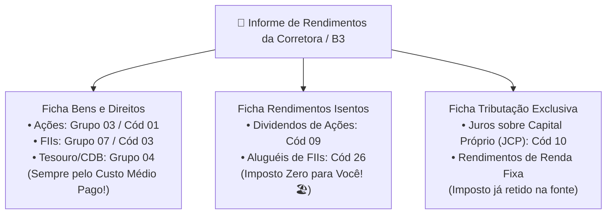

# Aula 8.2 — O Passo a Passo da Declaração: Bens, Dividendos & Exterior

Chegou o momento de desarmar qualquer receio operacional sobre como preencher o programa da Receita Federal.

Hoje, declarar seus investimentos na Bolsa de Valores é um processo extremamente rápido e quase todo automatizado. Com a integração do sistema **gov.br (Conta Prata ou Ouro)** e os relatórios anuais fornecidos pelas corretoras e pela B3, você consegue preencher toda a sua declaração em menos de meia hora.

Nesta aula prática, você terá o mapa das fichas exatas onde cada investimento do Norte Invest deve ser lançado no programa do IRPF.

---

## 🔑 1. O Recurso de Ouro: A Declaração Pré-Preenchida

Se você possui conta nível **Prata ou Ouro no portal gov.br**, nunca comece sua declaração do zero:
- Ao abrir o programa oficial do IRPF (ou preencher online pelo celular/computador), selecione a opção **"Iniciar com Declaração Pré-Preenchida"**.
- A Receita Federal já puxa automaticamente do banco de dados da B3 e das corretoras mais de **80% das suas ações, saldos em conta e rendimentos retidos**.
- O seu trabalho consiste basicamente em conferir os dados e ajustar o custo médio de aquisição.

---

## 🏛️ 2. Ficha: Bens e Direitos (O que Você Possui)

Todo ativo que você comprou e ainda mantinha em carteira no dia 31 de dezembro do ano-base deve ser informado nesta ficha:

### Ações Brasileiras:
- **Grupo:** `03 - Participações Societárias`
- **Código:** `01 - Ações (inclusive as listadas em bolsa)`
- **Localização:** `105 - Brasil`
- **CNPJ:** Digite o CNPJ da empresa (ex: Itaú, Weg, Engie).
- **Discriminação:** Descreva com clareza:  
  *Ex: "100 ações ordinárias da Weg S.A. (WEGE3), custodiadas na Corretora X, adquiridas pelo custo total de R$ 3.850,00."*
- **Situação em 31/12 do Ano Anterior e 31/12 do Ano Atual:** Informe o valor histórico somado que você efetivamente pagou pelas compras.

### Fundos Imobiliários (FIIs):
- **Grupo:** `07 - Fundos`
- **Código:** `03 - Fundos de Investimento Imobiliário (FII)`
- **CNPJ:** CNPJ do Fundo Imobiliário.
- **Discriminação:**  
  *Ex: "50 cotas do Fundo Imobiliário CSHG Logística (HGLG11), custodiadas na Corretora Y, pelo custo total de R$ 8.100,00."*

### Renda Fixa (Tesouro Direto e CDBs):
- **Grupo:** `04 - Aplicações e Investimentos`
- **Código:** `01 - Depósito a prazo e outros títulos (CDB)` ou `02 - Títulos públicos (Tesouro Direto)`.

---

## 💰 3. Onde Lançar os Proventos Recebidos no Ano?

Ao final de fevereiro de cada ano, a sua corretora e as empresas emitem o **Informe de Rendimentos Anual**. Você lançará os valores exatamente em duas fichas:

### Ficha: Rendimentos Isentos e Não Tributáveis
- **Tipo 09 — Lucros e Dividendos Recebidos:** Lance a soma dos dividendos pagos pelas suas ações ao longo do ano.
- **Tipo 26 — Outros:** Lance os rendimentos mensais distribuídos pelos seus Fundos Imobiliários (na descrição, escreva *"Rendimentos de cotas do FII [Código] - Isentos pela Lei 8.668/93"*).

### Ficha: Rendimentos Sujeitos à Tributação Exclusiva/Definitiva
- **Tipo 10 — Juros sobre Capital Próprio (JCP):** Lance o valor líquido recebido das empresas que pagaram JCP (o imposto de 15% já foi retido na fonte pela própria empresa, você não precisa pagar nada a mais).

---

## 🌎 4. Como Declarar Investimentos no Exterior?

Com a Lei 14.754/2023, o processo para declarar ativos nos EUA (como `VOO`, `VT` ou stocks) ficou unificado:
- **Na Ficha de Bens e Direitos:** Grupo `06 - Ativos no Exterior`, informando a quantidade de cotas, a corretora internacional e o valor em Reais convertido pelo câmbio da data de aquisição.
- **Na Ficha de Rendimentos no Exterior:** As corretoras internacionais voltadas para brasileiros (como Avenue ou Inter Global) disponibilizam um **Relatório Fiscal Anual pronto**, com cada linha e código exatamente traduzidos para copiar e colar na sua declaração.

---

## 📱 5. Aplicação Prática no App Norte Invest

No **Norte Invest V2 Enterprise**, você exporta tudo pronto:
1. Acesse o menu **Histórico** (`/historico`).
2. Utilize o filtro por ano fiscal para auditar o somatório de compras e proventos recebidos.
3. Consulte o **Preço Médio de Aquisição** oficial de cada papel no painel da **Carteira** (`/carteira`).

---

## ⚠️ 6. O Erro Fatal do Amador

> 🚫 **O Erro:** Deixar para organizar as notas de corretagem e extratos no último dia do prazo (31 de maio) e cair na malha fina por erro de digitação.
> 
> 🛡️ **A Postura Norte Invest:** Com o hábito dos 15 minutos mensais do Módulo 7, todas as suas compras já estão registradas no Norte Invest. Quando chega a época da declaração, basta baixar os informes da corretora e cruzar os dados com a declaração pré-preenchida do gov.br. É rápido, sereno e sem surpresas.

---

## 📊 7. Infográfico: O Mapa das Fichas do IRPF

---

## 🎙️ 8. Prompt para Áudio no Google NotebookLM

> **Como gerar o podcast desta aula:**
> 1. Copie o texto desta aula.
> 2. Cole como nova fonte em [notebooklm.google.com](https://notebooklm.google.com/).
> 3. No campo de personalização do *Audio Overview*, cole a instrução abaixo e clique em **Generate**:
> 
> *"Apresentem uma aula definitiva, prática e extremamente amigável sobre como preencher a declaração anual do Imposto de Renda sem estresse. Expliquem a facilidade da declaração pré-preenchida do gov.br, detalhem o código de cada ficha para Ações, FIIs e Ativos no Exterior, enfatizem por que o valor declarado é sempre o custo de aquisição e mostrem como a organização mensal do Norte Invest transforma o IRPF em uma tarefa rápida de 20 minutos."*
